# Programación de red con Python y UDP

**Ingeniería de Servicios · Práctica 1.3 · Curso 2026-2027**

**Alumno:** uo293890

**Fecha de comprobación:** 16 de noviembre de 2026

**Repositorio:** https://github.com/uo293890/IS-202627-01

**Directorio:** `1-3`

Esta práctica desarrolla una comunicación cliente-servidor sobre UDP y añade progresivamente numeración, confirmaciones, tiempos de espera y retransmisiones. Después utiliza broadcast para descubrir un servicio y despliega los programas en contenedores Docker. Las ejecuciones muestran que la aplicación puede detectar y recuperar algunas pérdidas, aunque UDP por sí mismo no garantiza entrega, orden ni ausencia de duplicados.

Se han comprobado los ejercicios 1 a 7, incluido el ejercicio 5 opcional, con doce bloques de verificación y una comprobación adicional de Docker. Cada apartado incluye una captura de la consola real de la máquina virtual. Los registros completos están en `memoria/evidencias` y las capturas originales en `memoria/capturas`.

Los servidores de los ejercicios 2, 3 y 5 mantienen una probabilidad de pérdida del 50 %. Durante su verificación se inicializó el generador con `random.seed(1)` desde el lanzador para obtener una secuencia repetible. Esto simula descartes en la aplicación; no significa que la red física haya perdido esos paquetes.

**Contenido:** entorno; UDP básico; pérdidas; confirmaciones; reintentos; detección de servidor ausente; mejoras del protocolo; broadcast; imágenes y volúmenes; UDP en Docker; DNS; tres servidores; ciclo de vida y ping; reproducción de las pruebas.

## Entorno de ejecución

La práctica se ejecutó en una máquina Ubuntu 24.04.5 LTS, denominada `is-99`, alojada en VirtualBox. El usuario de trabajo es `uo293890`. Python en la VM es la versión 3.12.3 y Docker tiene la versión 29.8.0 tanto en el cliente como en el servidor. Las imágenes utilizadas contienen Python 3.7.17 y 3.6.15.

La interfaz de la VM está conectada mediante adaptador puente. En esta ejecución su IP fue `10.38.10.40/16`, mientras que Windows tenía `10.38.10.146`. Estas direcciones permiten hacer la prueba entre dos máquinas del ejercicio 1. Son asignaciones de esta sesión y pueden cambiar por DHCP.

Se distinguen tres entornos: Windows, Ubuntu dentro de VirtualBox y los contenedores que ejecuta Docker dentro de Ubuntu. Para Docker, el anfitrión es Ubuntu. La red bridge predeterminada utiliza el rango `172.17.0.0/16`; la red propia `pruebas` utiliza `172.18.0.0/16`.

```bash
python3 --version
docker version
docker network inspect pruebas
```

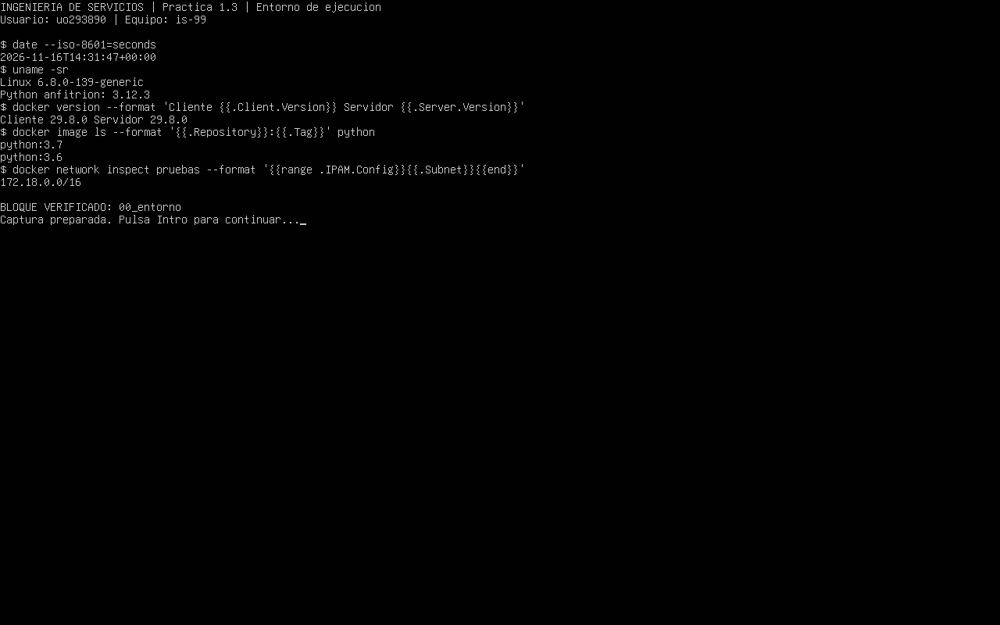

## Ejercicio 1 Comunicación UDP básica

`udp_servidor1.py` crea un socket `AF_INET` y `SOCK_DGRAM`, lo asocia mediante `bind(("", puerto))` y recibe datagramas con `recvfrom(1024)`. La dirección vacía permite escuchar en las interfaces IPv4 del equipo. Cada recepción devuelve los bytes del mensaje y la pareja IP y puerto del emisor.

`udp_cliente1.py` lee mensajes mediante `input()`, los codifica con UTF-8 y los envía con `sendto()`. La palabra `FIN` finaliza el cliente sin enviarse. El puerto predeterminado es 9999; el cliente utiliza por defecto la dirección de loopback. El mensaje con «niñez» comprueba que la codificación y la decodificación conservan la eñe.

La prueba local muestra dos datagramas procedentes de `127.0.0.1`. En la prueba entre máquinas se ejecutó el cliente desde Windows contra `10.38.10.40:19991`; el servidor registró el mensaje y la IP de origen `10.38.10.146`. El uso de 19991 verifica también el puerto configurable.

```bash
python3 udp_servidor1.py
python3 udp_cliente1.py
# Prueba desde Windows hacia el servidor configurado en 19991
python udp_cliente1.py 10.38.10.40 19991
```

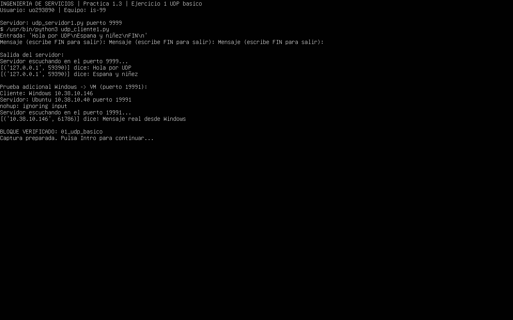

## Ejercicio 2 Pérdidas y números de secuencia

`udp_servidor2_simula_perdidas.py` decide con `random.randint(0, 1)` si descarta cada datagrama. Si lo descarta, imprime «Simulando paquete perdido»; en otro caso muestra el contenido. El sistema operativo sí recibió el datagrama: la pérdida se reproduce dejando de procesarlo en la aplicación.

`udp_cliente2_numera_mensajes.py` antepone un número a cada mensaje, con el formato `1: texto`, y lo incrementa con cada nuevo envío. Así se pueden detectar huecos en la secuencia recibida. En la ejecución se enviaron doce mensajes y el servidor mostró los números **3, 5, 6, 7, 8 y 11**. Los otros seis se descartaron en la simulación.

La probabilidad del 50 % no obliga a perder exactamente la mitad en cualquier muestra. El resultado de seis pérdidas entre doce mensajes corresponde a esta ejecución. La numeración revela los huecos, pero todavía no permite al cliente conocerlos porque el servidor no responde. Tampoco se ha observado reordenación en esta prueba local; UDP permite que ocurra en otras condiciones de red.

```bash
python3 udp_servidor2_simula_perdidas.py 19992
python3 udp_cliente2_numera_mensajes.py 127.0.0.1 19992
```

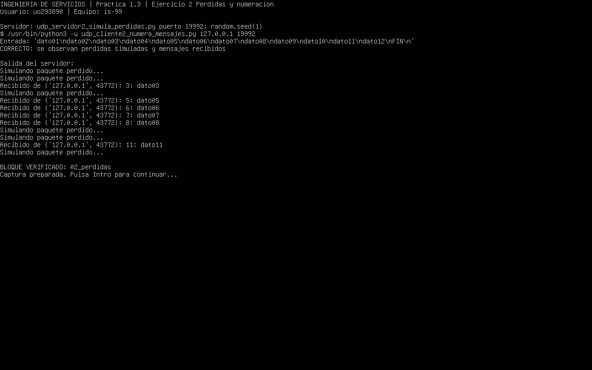

## Ejercicio 3 Confirmaciones y tiempo de espera

`udp_servidor3_con_ok.py` añade una respuesta `OK` cuando acepta un datagrama. Los mensajes descartados por la simulación no generan respuesta. El cliente `udp_cliente3_espera_ok.py` llama a `settimeout(0.1)` antes de esperar la confirmación, por lo que `recvfrom()` puede bloquear como máximo una décima de segundo.

Si llega `OK`, el cliente muestra la confirmación. Si vence el plazo, captura `socket.timeout` e informa del error sin quedar bloqueado indefinidamente. En esta versión no hay retransmisión: el usuario puede introducir otro mensaje. Por ello, la secuencia se incrementa con cada mensaje nuevo, incluso cuando el anterior no ha obtenido confirmación.

En la prueba de seis mensajes se confirmaron **3, 5 y 6**, y se agotó el plazo para **1, 2 y 4**. Las salidas del cliente y del servidor concuerdan. En una red real, un timeout también podría deberse a la pérdida del ACK o a una respuesta demasiado lenta; la ausencia de confirmación no identifica por sí sola la causa.

```bash
python3 udp_servidor3_con_ok.py 19993
python3 udp_cliente3_espera_ok.py 127.0.0.1 19993
```

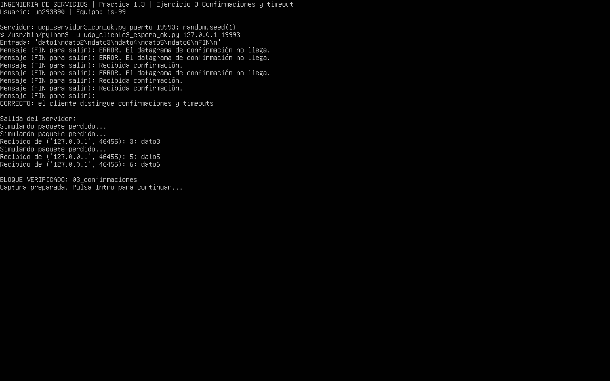

## Ejercicio 4 Retransmisión con espera creciente

`udp_cliente4_reintenta.py` conserva el datagrama completo mientras no se confirme. Comienza esperando 0,1 segundos y duplica el timeout después de cada vencimiento. El número de secuencia se incrementa únicamente al recibir `OK`, de modo que todos los intentos de entregar un mismo mensaje mantienen su identificador.

En la ejecución se simularon dos pérdidas consecutivas. El cliente efectuó envíos con plazos de **0,1, 0,2 y 0,4 segundos** y recibió confirmación en el tercer intento. El servidor mostró finalmente `1: Reintento con el mismo numero`. El código construye este texto antes de entrar en el bucle de retransmisión y lo reutiliza en cada intento.

La espera creciente reduce la frecuencia de los reenvíos cuando hay problemas. Aun así, esta versión acepta un `OK` sin comprobar a qué datagrama pertenece. Un ACK retrasado de un envío anterior puede provocar una interpretación incorrecta, lo que justifica la mejora del ejercicio opcional.

```bash
python3 udp_servidor3_con_ok.py 19994
python3 udp_cliente4_reintenta.py 127.0.0.1 19994
```

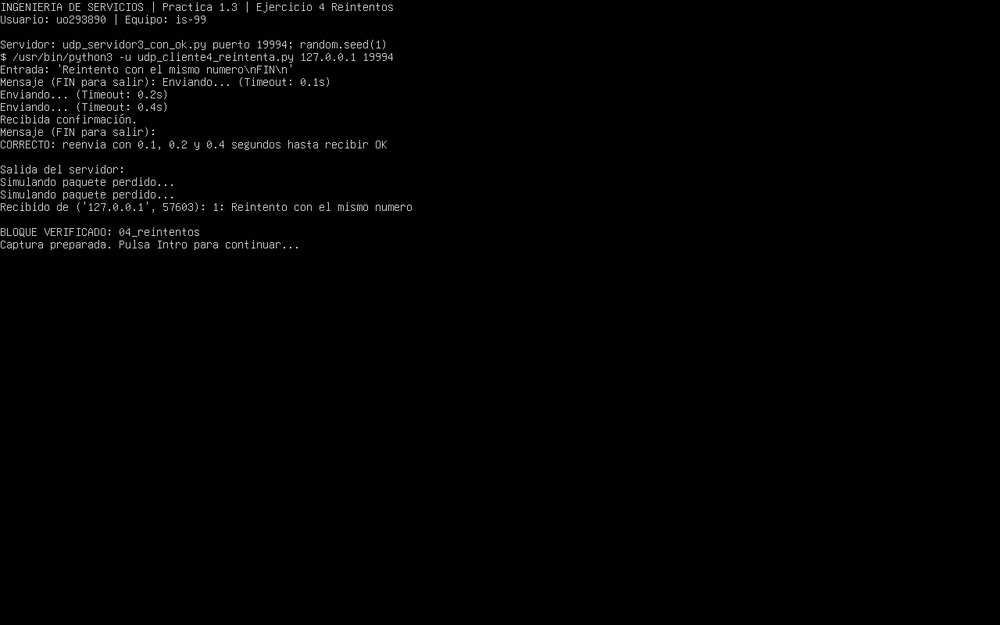

## Ejercicio 4 Detección de un servidor ausente

Para comprobar la condición de abandono se ejecutó el cliente contra `127.0.0.1:19995`, donde no había un servidor respondiendo. El cliente esperó sucesivamente **0,1, 0,2, 0,4, 0,8 y 1,6 segundos**. Tras el último timeout, la siguiente espera sería 3,2 segundos y superaría el límite de 2 segundos del guion.

El programa imprimió «Puede que el servidor esté caído. Inténtelo más tarde» y terminó con código de salida 1. No llegó a realizar una espera de 3,2 segundos. La suma de los plazos anteriores es **3,1 segundos**, a la que se añade el pequeño tiempo de ejecución del programa y de los envíos.

El aviso expresa una sospecha, no una prueba concluyente de caída. La misma ausencia de confirmaciones podría producirse por descartes, filtrado de tráfico o pérdida de respuestas. En este experimento la causa se conoce porque deliberadamente se eligió un puerto sin servicio.

```bash
python3 udp_cliente4_reintenta.py 127.0.0.1 19995
```

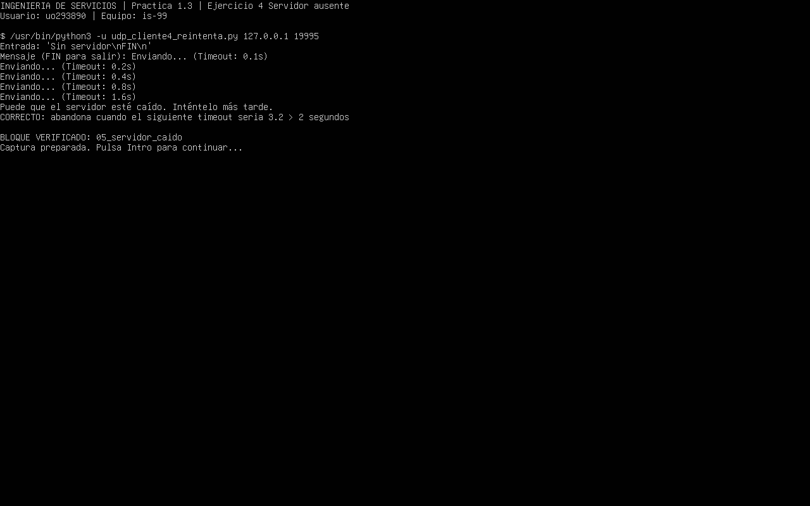

## Ejercicio 5 Identificación y control de duplicados

La versión opcional implementa tres mejoras. El servidor responde `OK:secuencia`; el cliente solo acepta el ACK correspondiente al mensaje que está enviando. Además, el cliente utiliza `connect()` en el socket UDP y después `send()` y `recv()`. En UDP esta llamada fija el interlocutor y filtra las recepciones por su IP y puerto; no establece una conexión TCP ni negocia una sesión.

El servidor conserva los identificadores ya procesados. La clave utilizada es **IP y puerto del cliente junto con su número de secuencia**, porque dos clientes distintos pueden empezar por 1. Si llega un duplicado, el servidor envía de nuevo el ACK sin repetir el procesamiento.

La prueba muestra dos clientes con secuencia 1 procesados correctamente y, después, un datagrama repetido desde el mismo socket marcado como duplicado. El cliente recibió `OK:1` en ambos envíos de esa comprobación. Si un ACK se perdiera, esta conducta permitiría retransmitir sin repetir la acción del servidor.

Esta solución es didáctica: la tabla permanece en memoria, crece durante la ejecución y se pierde al reiniciar el servidor. Una aplicación real necesitaría gestionar sesiones, caducidad y, si procede, autenticación. El filtrado del socket UDP no constituye autenticación criptográfica.

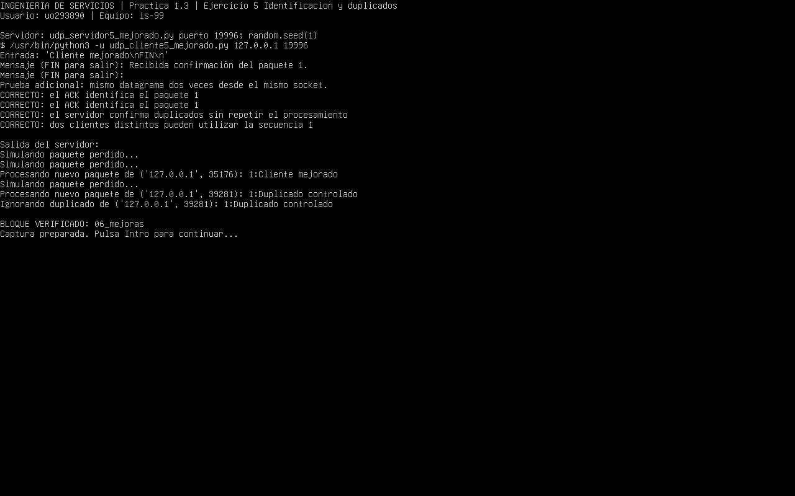

## Ejercicio 6 Descubrimiento por broadcast

El protocolo HOLA utiliza el puerto UDP 12345. `udp_servidor6_broadcast.py` responde a `BUSCANDO HOLA` con `IMPLEMENTO HOLA`, y a `HOLA` con `HOLA: IP`, siendo IP la del cliente. Tanto servidor como cliente configuran `SO_BROADCAST` siguiendo el guion; para enviar a una dirección de broadcast esta opción es necesaria.

El cliente difunde la búsqueda y recoge respuestas hasta que vence un timeout de dos segundos sin recibir otro datagrama. Muestra cada servidor una sola vez, conserva el primero que responde y le envía `HOLA` por unicast. La respuesta final se valida por su dirección de origen y su prefijo `HOLA:`.

Esta comprobación inicial se hizo con el broadcast de loopback `127.255.255.255` para verificar el intercambio en la propia VM. Se descubrió `127.0.0.1` y se obtuvo `HOLA: 127.0.0.1`. La prueba con varios servidores independientes se realiza en el ejercicio 7 mediante tres contenedores; no se atribuyen estas respuestas a máquinas de compañeros.

```bash
python3 udp_servidor6_broadcast.py
python3 udp_cliente6_broadcast.py 127.255.255.255
```

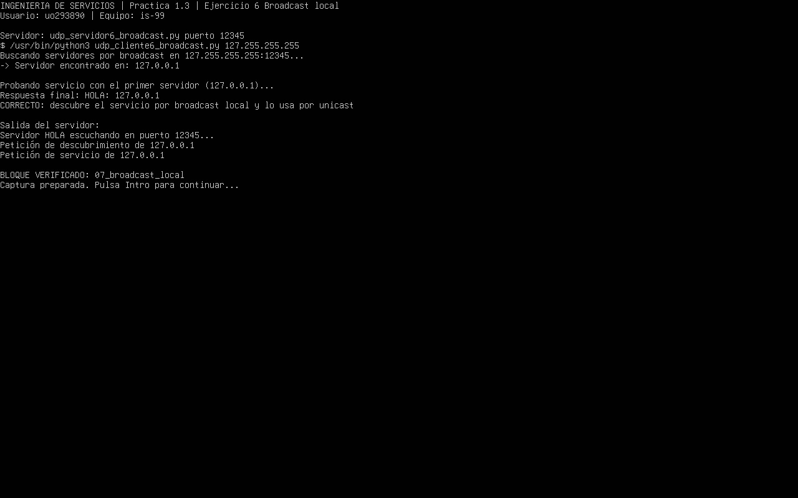

## Docker Imágenes volúmenes y aislamiento

`prueba.py` muestra la versión del intérprete que lo ejecuta. Se obtuvieron **3.12.3** en Ubuntu, **3.7.17** en la imagen `python:3.7` y **3.6.15** en `python:3.6`. Por tanto, el contenedor 3.6 tampoco utiliza la misma versión que el Python instalado en esta VM. Las versiones concretas difieren de los ejemplos históricos del guion.

La ejecución `docker run --rm python:3.7 python prueba.py` falló porque el archivo del anfitrión no existe automáticamente dentro del contenedor. Al montar la carpeta mediante `-v "$PWD:/app:ro"`, el mismo archivo quedó accesible como `/app/prueba.py` y pudo ejecutarse con ambas imágenes. El sufijo `:ro` permite leer el código y evita escribir en esa carpeta desde el contenedor.

También se borró `/usr/local/bin/python` dentro de un contenedor desechable. Allí dejó de encontrarse el comando, pero un contenedor nuevo creado desde la misma imagen volvió a ejecutar Python 3.7.17. La modificación afectó a la capa de escritura del primer contenedor, no a la imagen.

```bash
docker run --rm -v "$PWD:/app:ro" python:3.7 python /app/prueba.py
docker run --rm -v "$PWD:/app:ro" python:3.6 python /app/prueba.py
```

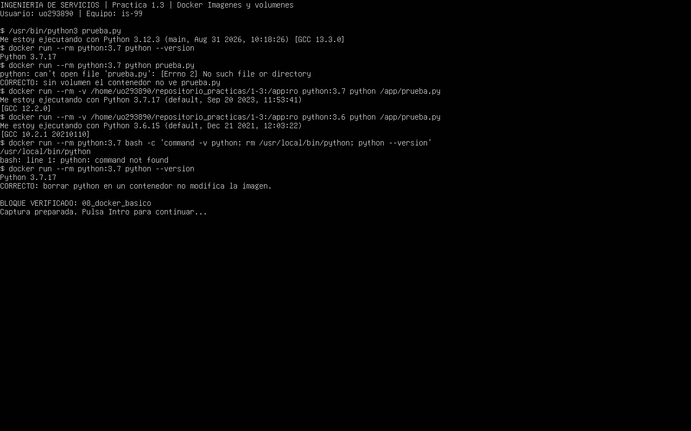

## Docker Servidor UDP en la red bridge

El servidor `udp_servidor3_con_ok.py` se lanzó en segundo plano con `docker run -d`, montando el código y utilizando `python -u` para que sus mensajes se escriban sin quedar retenidos en el búfer. El proceso principal del contenedor permanece esperando datagramas en el puerto 9999.

`docker inspect` mostró la dirección **172.17.0.2**. El cliente ejecutado directamente en Ubuntu pudo comunicarse con esa IP y recibir `OK` después de un reintento. Un segundo cliente, ejecutado en otro contenedor de la misma red bridge, también consiguió la confirmación. `docker exec ... ps -eo pid,args` mostró al servidor Python como proceso 1.

La conectividad desde Ubuntu se explica por la interfaz bridge que Docker crea en ese anfitrión. Windows y otras máquinas de la red física no tienen automáticamente una ruta hacia esa subred privada. Para exponer el servicio se podría publicar explícitamente un puerto UDP con `-p 9999:9999/udp`; esta publicación no fue necesaria en la prueba realizada.

```bash
docker inspect is13_verificacion_udp
python3 udp_cliente4_reintenta.py 172.17.0.2 9999
docker exec is13_verificacion_udp ps -eo pid,args
```

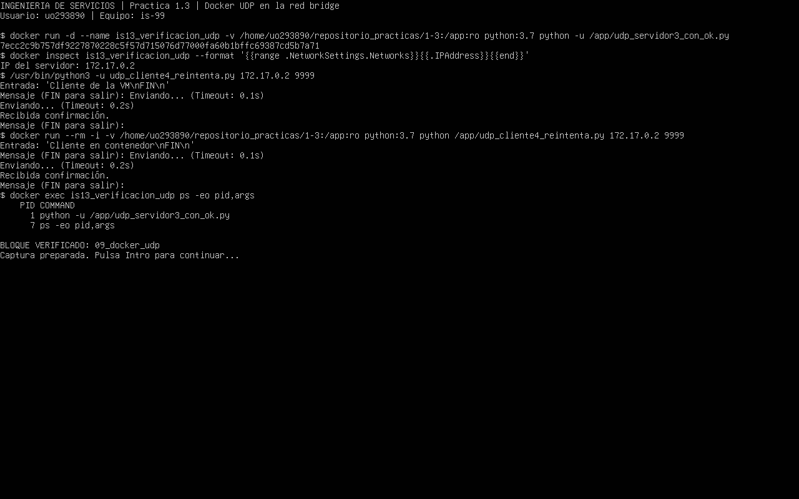

## Docker Red propia y resolución DNS

Una red bridge creada por el usuario, como `pruebas`, proporciona resolución de nombres entre sus contenedores. El servidor se lanzó con el nombre `is13_verificacion_dns` y conectado a esa red. Un segundo contenedor resolvió el nombre mediante `socket.gethostbyname()` y obtuvo **172.18.0.2**.

Después se ejecutó `udp_cliente4_reintenta.py` usando el nombre del servidor como argumento, sin escribir su IP. El servidor confirmó el mensaje y su registro mostró como origen **172.18.0.3**, correspondiente al contenedor cliente de esa ejecución. El nombre es más cómodo que una dirección asignada dinámicamente, pero debe poder resolverse desde la red donde se ejecuta el cliente.

La comprobación adicional de ping se recoge más adelante. Se instaló `iputils-ping` en un contenedor de prueba, como propone el guion, y se verificó que el nombre del servidor resolvía y era accesible. La resolución DNS y la respuesta UDP son comprobaciones distintas: resolver un nombre no garantiza por sí solo que el servicio esté escuchando.

```bash
docker network inspect pruebas
docker run --rm --network pruebas python:3.7 python -c \
  "import socket; print(socket.gethostbyname('is13_verificacion_dns'))"
```

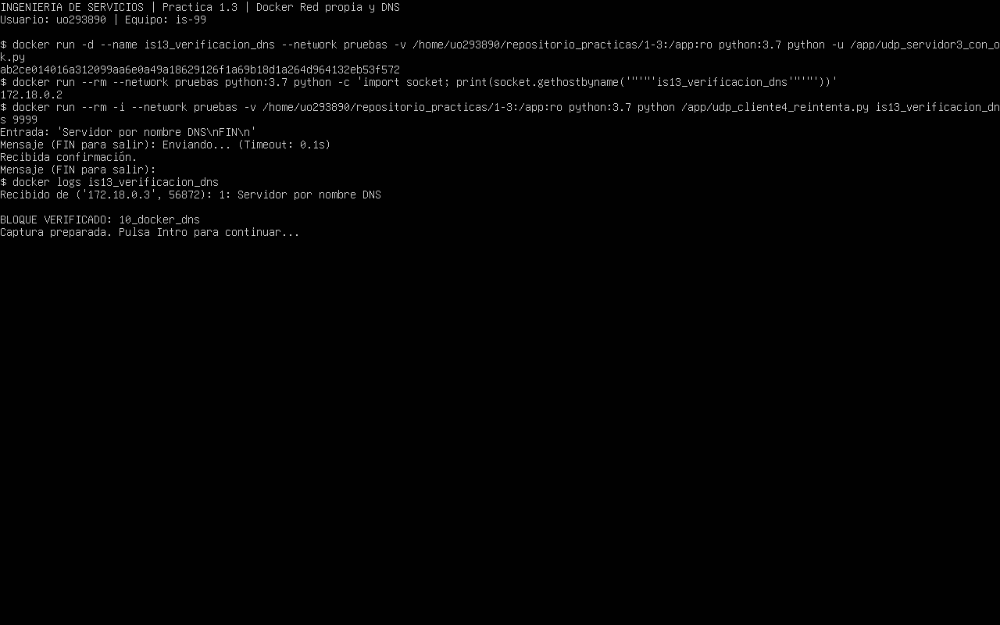

## Ejercicio 7 Tres servidores en Docker

`udp_docker_lanzar_servidores.sh` prepara la red `pruebas` y ejecuta tres contenedores llamados `server_hola_1`, `server_hola_2` y `server_hola_3`. Los scripts calculan la carpeta donde están guardados, por lo que no dependen de lanzar el comando desde un directorio concreto. Un segundo arranque reutiliza los contenedores existentes.

La inspección mostró una IP con prefijo **/16**. En `172.18.0.0/16`, los últimos 16 bits corresponden a los hosts; al ponerlos todos a 1 se obtiene **172.18.255.255**. El script del cliente calcula esta dirección con `ipaddress` a partir de la subred que informa Docker y se la pasa al programa Python.

En esta ejecución se descubrieron, en este orden, **172.18.0.5, 172.18.0.4 y 172.18.0.3**. El cliente eligió `172.18.0.5`, el primero que respondió. El resultado **`HOLA: 172.18.0.6`** identifica la IP del cliente dentro de Docker, no la IP de Windows ni la de la interfaz física de Ubuntu. El orden de las respuestas puede variar entre ejecuciones.

```bash
bash udp_docker_lanzar_servidores.sh
bash udp_docker_lanzar_cliente.sh
bash udp_docker_parar_servidores.sh
```

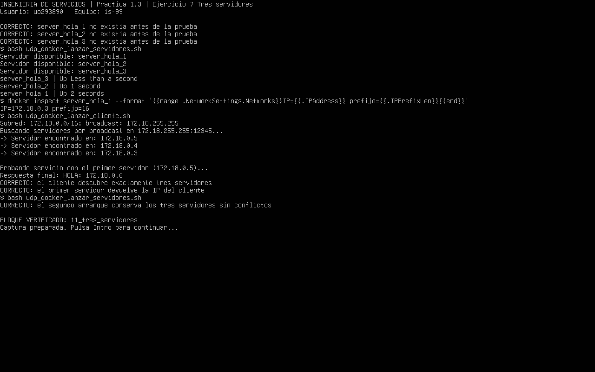

## Docker Ciclo de vida y comprobación con ping

Al ejecutar la imagen `python:3.7` sin entrada interactiva ni un programa persistente, el intérprete termina y el contenedor queda detenido. La prueba creó `is13_verificacion_ciclo` sin `--rm`; `docker ps -a` lo mostró como **Exited (0)**. El contenedor se eliminó después mediante `docker rm` usando su nombre concreto.

Un contenedor detenido conserva su capa de escritura mientras exista; eliminar el contenedor no elimina la imagen de la que procede. La opción `--rm` automatiza esa eliminación al terminar. En los clientes de los scripts se conserva `-i`, y solo se añade `-t` cuando existe una terminal real, lo que permite ejecutarlos también desde un verificador.

Para la prueba de red se creó el servidor `is13_verificacion_ping` en `pruebas` y otro contenedor instaló `iputils-ping`. El nombre resolvió a **172.18.0.2** y se recibieron **dos respuestas de dos paquetes enviados, con 0 % de pérdida**. Los contenedores temporales de verificación se retiraron al terminar. No se utilizó una limpieza global de los recursos Docker de otras prácticas.

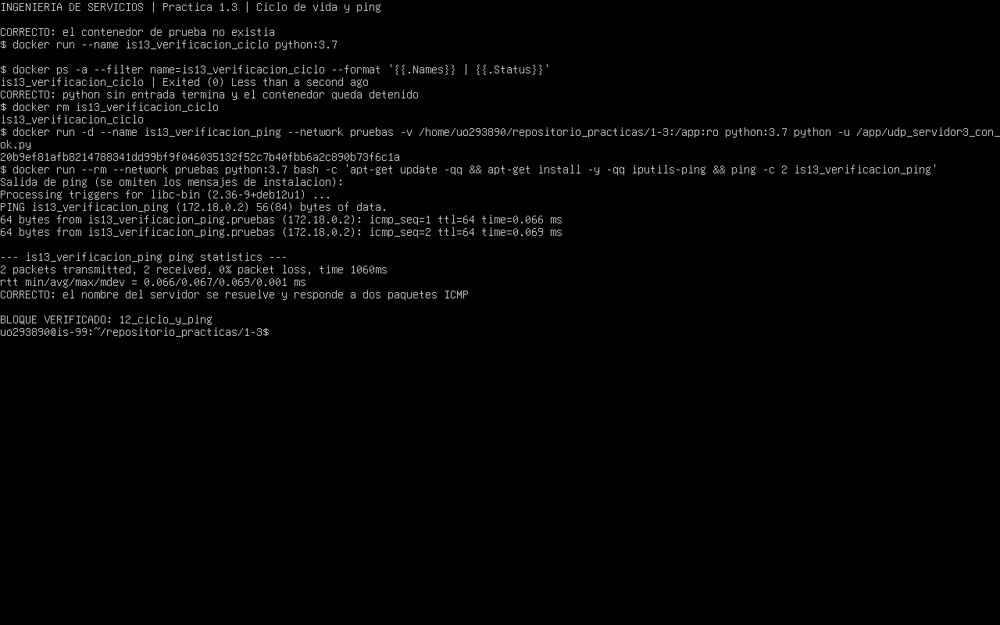

## Reproducción y conclusiones

Los programas se ejecutan con la biblioteca estándar de Python. El verificador necesita Python 3.8 o posterior en Ubuntu, Docker accesible para el usuario, las imágenes `python:3.7` y `python:3.6`, y la red `pruebas` creada. Los puertos 9999, 12345 y 19992 a 19996 deben estar libres. Si ya existen los tres contenedores `server_hola_*`, deben revisarse y detenerse antes de ejecutar la verificación completa.

```bash
cd ~/repositorio_practicas/1-3
docker pull python:3.7
docker pull python:3.6
# Crear pruebas únicamente si todavía no existe
docker network inspect pruebas >/dev/null 2>&1 || docker network create pruebas
python3 verificar_practica.py
python3 verificar_docker_adicional.py
```

Para obtener capturas paso a paso se utiliza `python3 verificar_practica.py --capturas`. El verificador ejecuta los clientes y servidores reales, guarda la salida de cada bloque en `memoria/evidencias` y registra doce resultados correctos en `resultados.json`. La comprobación adicional se guarda como `12_ciclo_y_ping.txt`. Volver a ejecutar estas herramientas actualiza los registros. La prueba Windows-VM del ejercicio 1 se realiza desde el anfitrión y su registro se conserva por separado.

Las capturas originales son imágenes PNG obtenidas de la pantalla de VirtualBox. En el PDF se limita el espacio mostrado a la zona con texto para facilitar la lectura; los archivos originales permanecen completos. Las IP, los puertos efímeros y los identificadores Docker que aparecen son los observados en esta sesión.

Los resultados permiten relacionar cada mejora con un problema concreto: los números revelan pérdidas, los ACK informan de recepciones, los timeouts evitan esperas indefinidas, los reintentos recuperan algunas pérdidas y los identificadores ayudan a distinguir confirmaciones y duplicados. El ejemplo HOLA separa el descubrimiento por broadcast del uso del servicio por unicast. Docker permite repetir estas comunicaciones en redes privadas con procesos aislados y nombres DNS.

El protocolo sigue siendo una solución de laboratorio: no implementa seguridad criptográfica, control de congestión completo, persistencia de la tabla de duplicados ni garantías generales de entrega. Se han probado pérdidas simuladas, no condiciones arbitrarias de una red real.

**Referencia de trabajo:** guion «Sesión 1.3 Programación de red con python. UDP», Ingeniería de Servicios, curso 2026-2027, facilitado desde el campus virtual. Los ejemplos de versiones antiguas del guion se han contrastado con las versiones realmente disponibles en la VM.
