# Programación de red con Python y TCP

**Ingeniería de Servicios · Práctica 1.4 · Curso 2026-2027**

**Alumno:** uo293890

**Fecha de comprobación:** 16 de noviembre de 2026

**Repositorio:** https://github.com/uo293890/IS-202627-01

**Directorio:** `1-4`

Esta práctica estudia cómo delimitar mensajes dentro de una conexión TCP. Aunque TCP ofrece un flujo de bytes ordenado y mecanismos de retransmisión, no conserva las fronteras entre las escrituras de la aplicación. Por eso, un receptor necesita conocer el tamaño del mensaje, detectar un delimitador o interpretar una cabecera con su longitud.

Se implementan y comparan los tres enfoques del guion: bloques de cinco bytes, líneas terminadas en CRLF y mensajes precedidos por su longitud. El servicio utilizado es OCHE, que devuelve el texto recibido con sus caracteres en orden inverso. Finalmente se despliega en Docker y se comprueba la publicación de un puerto para acceder desde Windows.

La comprobación comprende los ejercicios 1 a 7, incluido el opcional, y los experimentos con fragmentación y agrupación de mensajes. Se han ejecutado trece bloques y se incluyen sus capturas reales de VirtualBox. Los seis archivos que ya existían, correspondientes a los ejercicios 2, 5 y 7, se han probado sin modificar su contenido.

Los registros completos están en `memoria/evidencias`, las capturas originales en `memoria/capturas` y el resumen de comprobaciones en `resultados.json`. Los resultados distinguen las respuestas correctas de los fallos provocados deliberadamente para estudiar el framing.

## Entorno y método de comprobación

La ejecución se realizó en Ubuntu 24.04.5 LTS dentro de VirtualBox, con el usuario `uo293890`, el equipo `is-99`, Python 3.12.3 y Docker 29.8.0. Los contenedores utilizaron la imagen `python:3.7`, disponible de la práctica anterior. La red propia `pruebas` tiene la subred `172.18.0.0/16`.

La VM utiliza un adaptador puente y en esta sesión tenía la IP `10.38.10.40`. Windows actuó como cliente externo para verificar el servicio publicado. Los ejercicios locales se ejecutaron en puertos diferentes entre 20101 y 20111 para que las pruebas no dependieran de reutilizar inmediatamente un mismo puerto TCP.

En los experimentos que requieren agrupar datos se añadió una espera de un segundo después de aceptar la conexión. El verificador introduce ese retardo durante la ejecución, sin editar los archivos de los ejercicios. Los servidores nuevos también permiten activarlo manualmente mediante `RETARDO_LECTURA=1`. El retardo controla cuándo se leen los datos; no representa una medición de congestión de la red.

```bash
python3 --version
docker version
docker network inspect pruebas
```

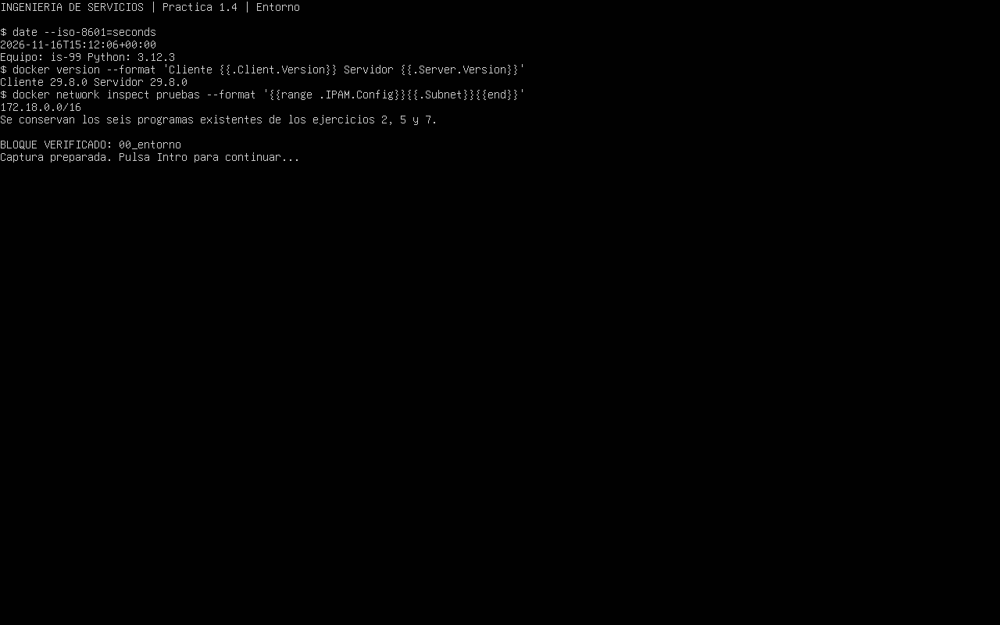

## Ejercicio 1 Bloques de cinco bytes

`tcp_servidor1_simple.py` crea un socket TCP, ejecuta `bind()` y `listen(5)` y atiende los clientes que acepta. Cada `accept()` devuelve un socket de datos diferente del socket de escucha. El servidor utiliza `recv(5)` sobre el socket de datos y finaliza la atención a ese cliente cuando obtiene `FINAL` o detecta el cierre del otro extremo.

`tcp_cliente1_simple.py` conecta con la dirección y el puerto indicados, envía cinco veces `ABCDE` mediante `send()` y después envía `FINAL`. Ambos programas admiten el puerto 9999 como valor predeterminado y el cliente usa `localhost` si no se indica servidor.

En la ejecución, cada llamada a `send()` devolvió 5 y el servidor mostró cinco bloques `ABCDE`, seguidos de la marca de finalización. Este resultado no demuestra que cada envío equivalga siempre a una recepción. `send()` informa de cuántos bytes ha aceptado para enviar y puede devolver un número menor que el solicitado. Del mismo modo, el 5 de `recv(5)` es un máximo de lectura, no una promesa de recibir exactamente cinco bytes.

```bash
python3 tcp_servidor1_simple.py 20101
python3 tcp_cliente1_simple.py 127.0.0.1 20101
```

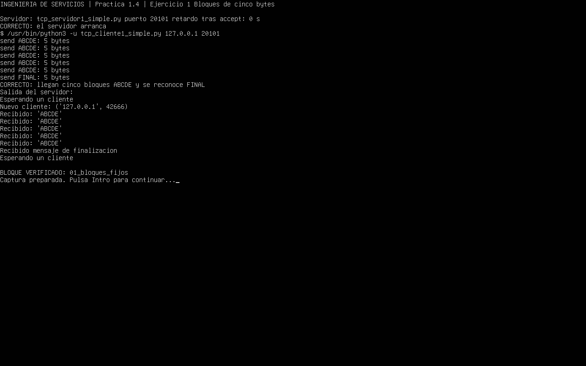

## Ejercicio 2 Envío completo y recepción acumulada

El cliente existente `tcp_cliente2_sendall.py` utiliza `sendall()` para enviar todo el contenido indicado o comunicar un error. El servidor existente `tcp_servidor2_recvall.py` acumula datos mediante `recvall(socket, n)`, pidiendo en cada iteración únicamente los bytes restantes. La función devuelve `None` si el otro extremo cierra antes de completar el bloque.

Para comprobar la diferencia se enviaron `A`, `BC` y `DE` con pequeñas pausas. El servidor simple imprimió esos tres fragmentos por separado, a pesar de llamar a `recv(5)`. Con la misma secuencia de escrituras, la versión con `recvall()` mostró un único bloque `ABCDE`.

También se ejecutó el cliente original del ejercicio 2: sus cinco bloques y `FINAL` se recibieron correctamente. `recvall()` resuelve la lectura parcial cuando se conoce la cantidad esperada, pero no permite averiguar por sí sola qué tamaño tenía cada mensaje que quiso enviar el cliente. Ambos extremos deben cumplir el mismo formato.

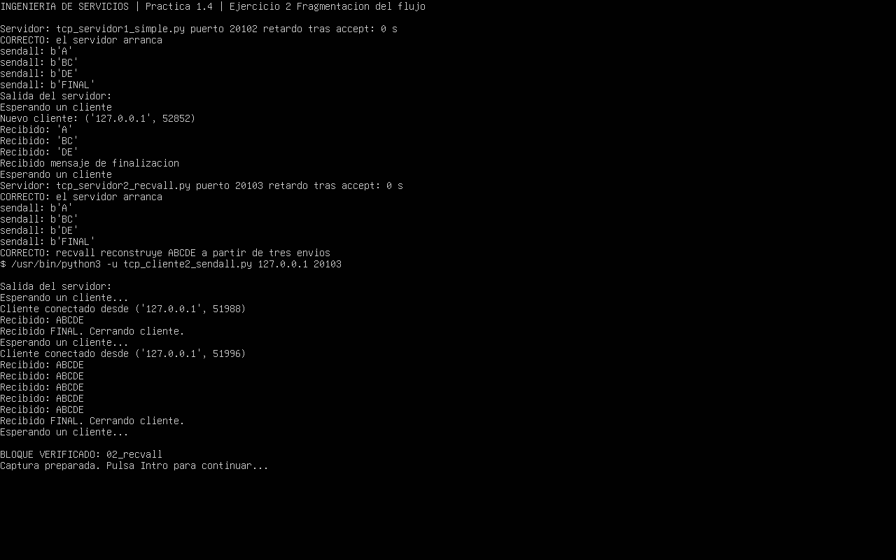

## Experimento ABCD y alineación de la marca final

Se repitió la idea del guion enviando mensajes de cuatro bytes a un receptor que los interpreta en bloques de cinco. Con el servidor simple retrasado un segundo, se enviaron cinco mensajes `ABCD` seguidos de `FINAL`. El servidor mostró `ABCDA`, `BCDAB`, `CDABC` y `DABCD`. Los mensajes se habían agrupado y las lecturas ya no coincidían con las escrituras originales.

En este caso concreto `FINAL` sí se reconoció: los cinco mensajes de cuatro bytes suman 20 bytes, una cantidad divisible entre cinco. Es decir, el contenido anterior se desalineó respecto a los mensajes del cliente, pero la marca volvió a caer en una frontera válida. El fallo de detección descrito en el guion no es inevitable para esa cantidad de envíos.

Para mostrar también la pérdida de sincronización de la marca se enviaron tres mensajes `ABCD` al servidor con `recvall()`. Los doce bytes anteriores a `FINAL` hicieron que el servidor leyera `ABCDA`, `BCDAB` y `CDFIN`. Los dos bytes restantes, `AL`, no completaban un bloque. Al cerrar el cliente, `recvall()` devolvió `None` y no se detectó un bloque igual a `FINAL`.

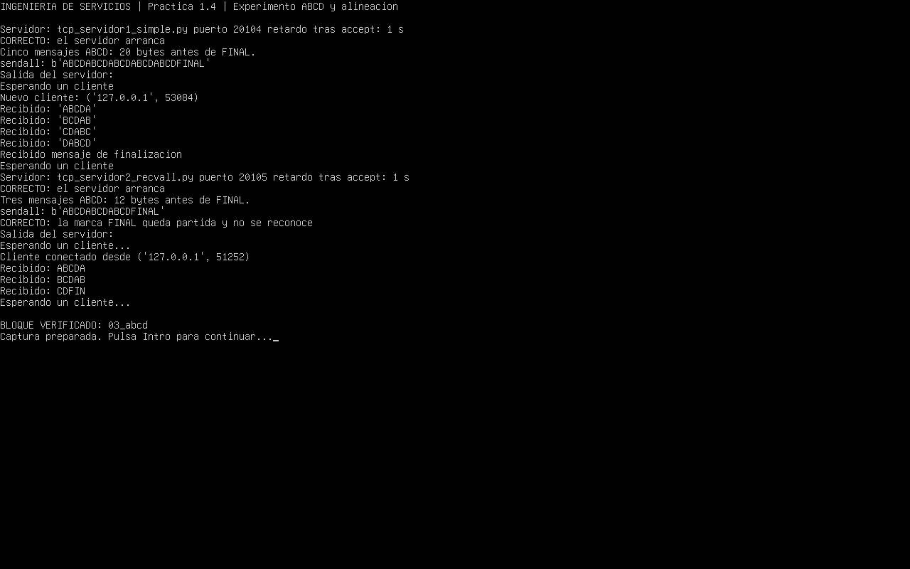

## Ejercicio 3 Servicio OCHE simplista

`tcp_servidor3_oche_simplista.py` implementa la primera aproximación del guion. Recibe hasta 80 bytes, decodifica el texto, elimina los dos últimos caracteres que presupone iguales a CRLF y devuelve `linea[::-1]` con `\r\n` añadido. La atención termina cuando `recv()` devuelve una cadena de bytes vacía, que indica el cierre de la conexión.

`tcp_cliente3_oche.py` envía una línea y lee su respuesta antes de enviar la siguiente. Con `UNO`, `DOS` y `TRES` se obtuvieron `ONU\r\n`, `SOD\r\n` y `SERT\r\n`. La captura muestra tanto las respuestas del cliente como los bytes observados por el servidor.

El resultado depende de una suposición incorrecta: que cada `recv(80)` entrega exactamente una línea completa. Puede entregar solo una parte de una línea o varias líneas juntas. El servidor simplista se conserva precisamente para reproducir ese problema; añadir `sendall()` no establece fronteras entre mensajes en el extremo receptor.

```bash
python3 tcp_servidor3_oche_simplista.py 20106
python3 tcp_cliente3_oche.py 127.0.0.1 20106
```

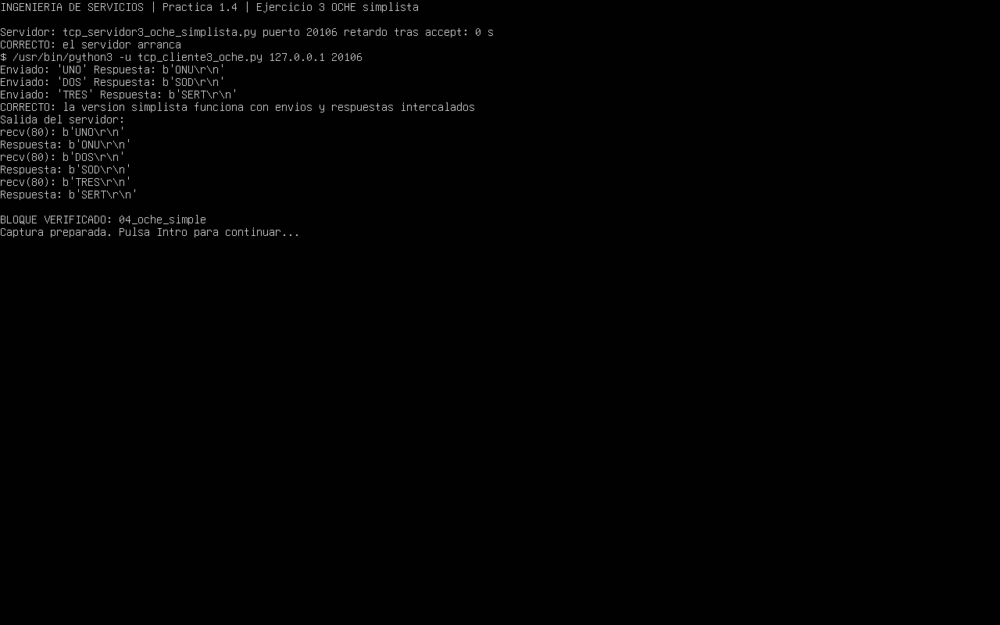

## Experimento Tres líneas en una recepción

El cliente `tcp_cliente3_oche_envia_seguido.py` envía primero tres líneas y después intenta leer tres respuestas. El servidor espera un segundo antes de leer para favorecer que los datos ya estén acumulados. En esta ejecución, un solo `recv(80)` devolvió `UNO\r\nDOS\r\nTRES\r\n`.

El servidor eliminó únicamente los dos últimos caracteres e invirtió todo el resto como si fuese un mensaje. La respuesta real fue `SERT\n\rSOD\n\rONU\r\n`: también invirtió los delimitadores interiores. La respuesta correcta habría sido tres mensajes independientes: `ONU\r\n`, `SOD\r\n` y `SERT\r\n`.

El primer `recv()` del cliente recibió esa respuesta agrupada. El siguiente agotó el timeout de tres segundos porque no quedaban más respuestas. Se añadió ese plazo al cliente de demostración para observar el bloqueo sin dejar el experimento esperando indefinidamente. El código de salida 1 es aquí el resultado esperado del experimento, no un fallo del verificador.

```bash
RETARDO_LECTURA=1 python3 tcp_servidor3_oche_simplista.py 20107
python3 tcp_cliente3_oche_envia_seguido.py 127.0.0.1 20107
```

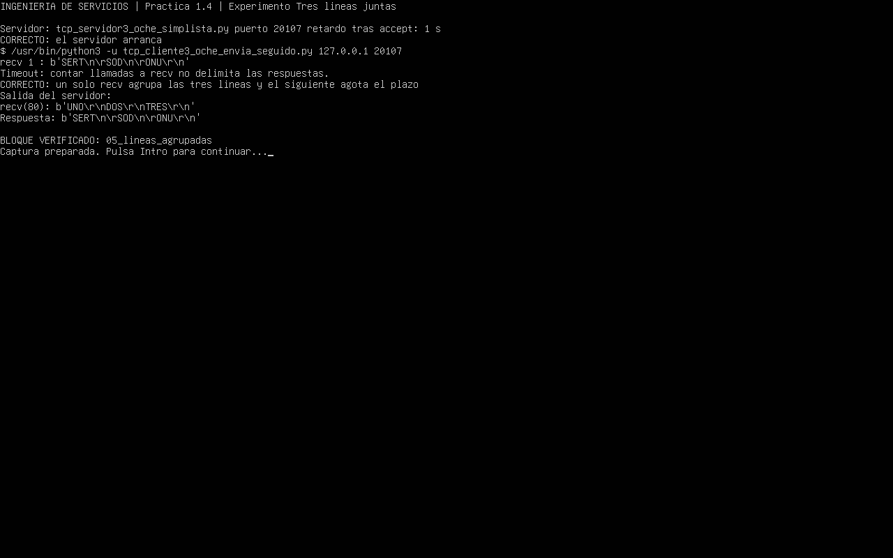

## Ejercicio 4 Delimitador CRLF byte a byte

Las versiones `tcp_servidor4_oche_mejorado.py` y `tcp_cliente4_oche_mejorado.py` usan `recibe_mensaje()` para leer un byte cada vez hasta detectar la pareja `\r\n`. Cada byte se añade a una lista y al terminar se concatenan mediante `b"".join(buffer)`, evitando reconstruir una cadena completa con cada concatenación.

Los bytes de una línea se decodifican solo cuando ya se dispone del mensaje completo. De ese modo, una letra UTF-8 que ocupe varios bytes puede llegar fragmentada sin intentar decodificar una secuencia incompleta. La inversión se aplica al texto sin los dos bytes del delimitador y después se añade de nuevo CRLF.

La prueba con un segundo de retardo obtuvo las tres respuestas correctas. Se comprobó además `mañana`, partiendo los dos bytes de la eñe entre escrituras, una línea de 160 caracteres y una línea vacía. Los tres casos fueron correctos. Una línea vacía sigue teniendo su terminador `\r\n`; se distingue del fin de conexión, que la función representa con `None`.

Esta técnica es sencilla, aunque una llamada a `recv(1)` por byte añade trabajo que puede reducirse con un búfer.

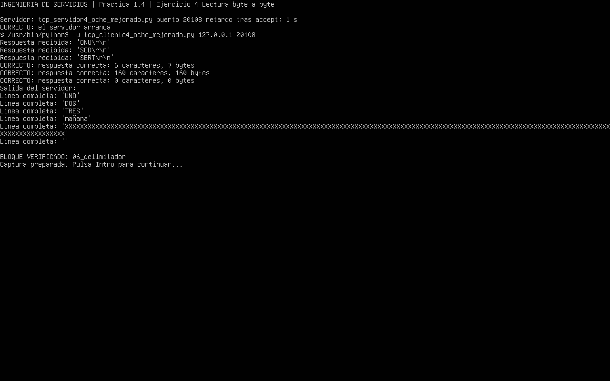

## Ejercicio 5 Lectura de líneas mediante makefile

Los programas originales `tcp_servidor5_oche_readline.py` y `tcp_cliente5_oche_readline.py` emplean `makefile(mode="r", encoding="utf8", newline="\r\n")`. Esto proporciona un objeto de fichero con búfer sobre el socket, cuyo método `readline()` permite obtener cada línea completa y realizar su decodificación.

Si una lectura interna obtiene varias líneas, el fichero conserva en su búfer lo que sobra para la llamada siguiente. Si una línea llega en varias partes, sigue leyendo hasta completarla. El programa puede centrarse en procesar una línea cada vez sin depender del número de escrituras que hizo el otro extremo.

Los dos archivos existentes se ejecutaron sin modificar. Con un segundo de espera después de `accept()` se obtuvieron correctamente `ONU`, `SOD` y `SERT`, cada uno terminado en CRLF. Las pruebas adicionales con una eñe fragmentada, 160 caracteres y una línea vacía también fueron correctas.

Es importante que las lecturas de una conexión sean coherentes con el búfer utilizado. Mezclar `readline()` del fichero con `recv()` directo del mismo socket puede omitir datos que ya estén almacenados en el fichero y aún no hayan sido consumidos por la aplicación.

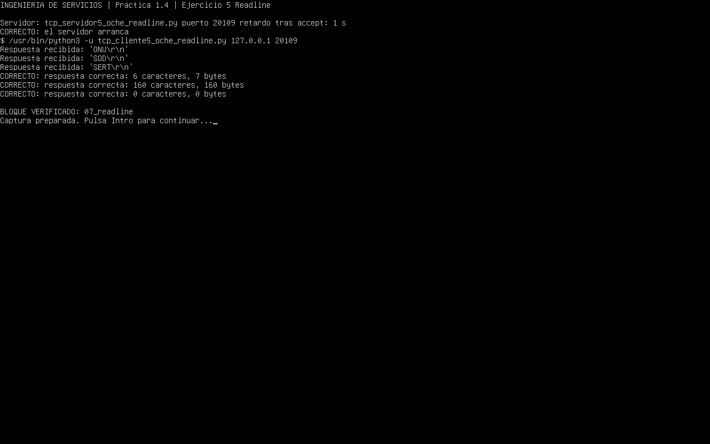

## Ejercicio 6 Longitud en ASCII y cuerpo UTF8

La siguiente solución antepone al cuerpo una cabecera con la longitud expresada en ASCII y terminada en LF. Por ejemplo, `mañana` contiene seis caracteres y ocupa siete bytes en UTF-8, por lo que su trama comienza con `7\n`. La longitud se calcula después de codificar el mensaje, no mediante el número de caracteres del texto.

El servidor lee la cabecera con `readline()` sobre un fichero binario y después obtiene el cuerpo con `f.read(longitud)`. Todas las lecturas pasan por el mismo fichero para respetar su búfer. La respuesta utiliza exactamente el mismo formato. El tamaño declarado permite que el cuerpo incluya CRLF sin confundirlo con un delimitador del mensaje.

Se comprobaron `UNO`, `DOS`, `TRES`, `mañana`, `uno\r\ndos` y un mensaje vacío. En este último caso la cabecera es `0\n` y el cuerpo tiene longitud cero. También se partieron la cabecera y los bytes de la eñe entre escrituras; se reconstruyó correctamente `mañana` y se recibió `anañam`.

Los programas son `tcp_servidor6_oche_len.py` y `tcp_cliente6_oche_len.py`. Se incluye además `tcp_cliente.6_oche_len.py` como alias del nombre que aparece escrito en el guion.

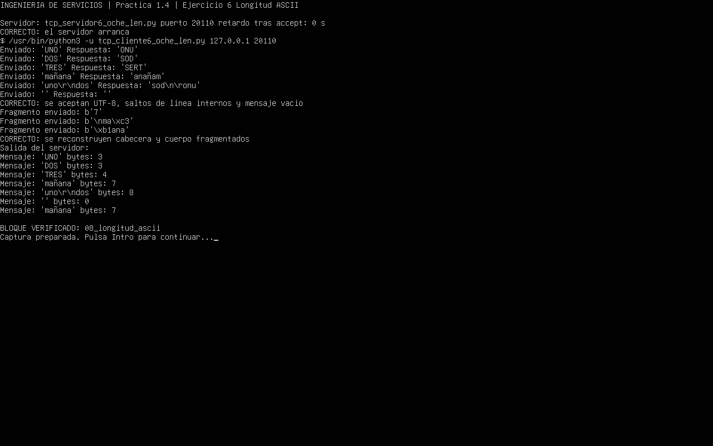

## Ejercicio 7 Longitud binaria de dos bytes

Los programas originales del opcional anteponen dos bytes codificados con `struct.pack(">H", longitud)`. El símbolo `>` selecciona big endian y `H` un entero sin signo de 16 bits. El receptor acumula exactamente dos bytes con `recvall()`, obtiene la longitud con `struct.unpack()` y recibe después el cuerpo completo.

Las comprobaciones del intérprete dieron `struct.pack(">H", 15) == b"\x00\x0f"` y `struct.pack("<H", 15) == b"\x0f\x00"`. Cambia el orden de los bytes, no el valor representado. Por su parte, `struct.unpack(">H", b"\x00\x10")` devolvió la tupla `(16,)`.

Con dos bytes sin signo se pueden representar longitudes de **0 a 65535 bytes**, no una longitud de 65536. Intentar empaquetar 65536 produjo `struct.error`. En este formato, el cuerpo no necesita ningún delimitador especial.

El cliente original envió `mañana` y obtuvo `anañam`. Otra comprobación separó los dos bytes de la cabecera y partió la eñe entre escrituras; el servidor existente reconstruyó el mensaje y respondió correctamente. Se mantuvieron intactos los dos archivos del ejercicio opcional.

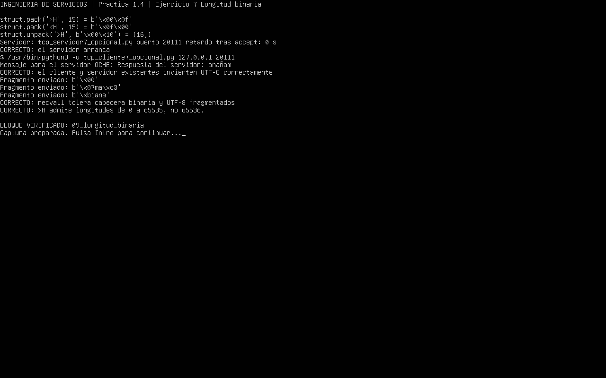

## Docker Comunicación dentro de la red privada

Se desplegó el servidor original del ejercicio 5 en un contenedor llamado `is14_oche`, conectado a `pruebas`. El código se montó en `/app` con acceso de lectura y se utilizó `python -u`. El contenedor cliente, conectado a la misma red, accedió al servidor mediante su nombre y el puerto interno 9999.

El cliente obtuvo las tres líneas esperadas. El nombre se resuelve dentro de esa red de Docker y evita depender de la IP que se haya asignado al servidor. Esta ejecución no publicaba ningún puerto de Ubuntu hacia el contenedor.

El servidor se lanzó con `--rm`. Después de detenerlo se comprobó que ya no existía mediante `docker inspect`, lo que permitió reutilizar su nombre en el siguiente experimento. La opción elimina el contenedor al terminar; no elimina su imagen ni la carpeta de código montada desde Ubuntu.

```bash
docker run -d --rm --network pruebas --name is14_oche \
  -v "$PWD:/app:ro" python:3.7 \
  python -u /app/tcp_servidor5_oche_readline.py
```

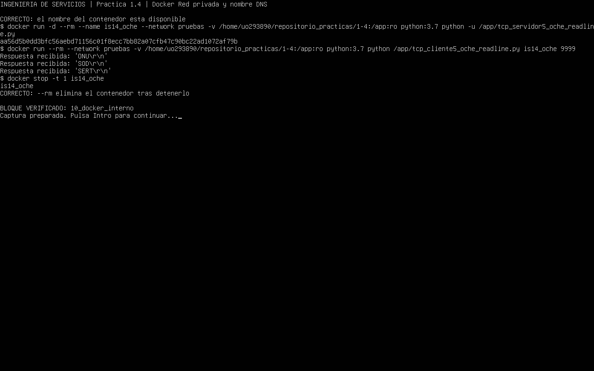

## Docker Puerto publicado y acceso desde Windows

Se volvió a lanzar el servidor añadiendo `-p 9090:9999`. El primer número es el puerto de Ubuntu y el segundo el puerto del servidor dentro del contenedor. Al omitir un sufijo, Docker publica TCP. Para UDP habría que indicarlo explícitamente.

`docker ps` mostró `0.0.0.0:9090->9999/tcp` y el mapeo IPv6 equivalente. Desde Ubuntu, el cliente original accedió mediante `localhost 9090` y obtuvo `ONU\r\n`, `SOD\r\n` y `SERT\r\n`.

Después se ejecutó realmente ese mismo cliente desde Windows, con `10.38.10.40 9090`. También obtuvo las tres respuestas y terminó con código 0. Esta es la comprobación entre equipos de la sesión: el cliente de Windows llega a la IP de Ubuntu y Docker encamina el tráfico al puerto 9999 del contenedor. Como VirtualBox utiliza adaptador puente, no se necesitó una redirección NAT adicional de VirtualBox.

```bash
docker run -d --rm -p 9090:9999 --network pruebas --name is14_oche \
  -v "$PWD:/app:ro" python:3.7 \
  python -u /app/tcp_servidor5_oche_readline.py
python3 tcp_cliente5_oche_readline.py localhost 9090
```

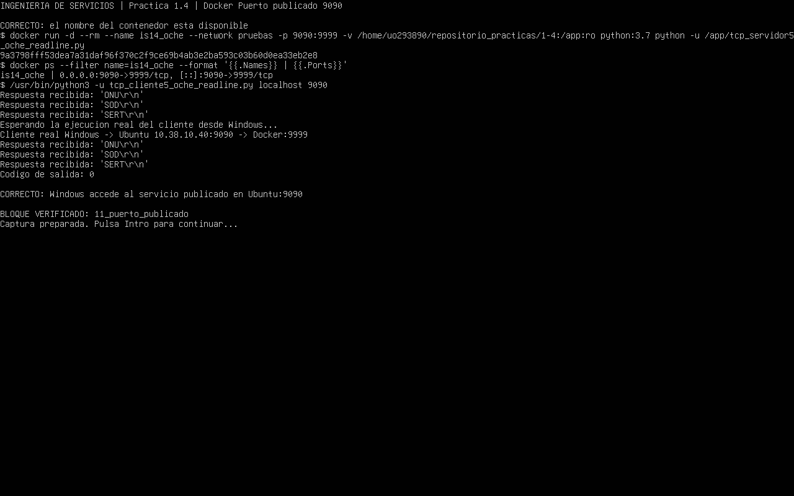

## Docker Cliente desde otra subred

Para estudiar el experimento adicional se creó la red temporal `is14_externa_verificacion`, separada de `pruebas`. Un contenedor cliente en esa red informó de la IP **172.20.0.2**. Se conectó a **10.38.10.40:9090**, es decir, a la dirección de Ubuntu y al puerto publicado, y obtuvo las tres respuestas correctas.

Esta prueba utiliza dos subredes Docker en la misma VM. No se presenta como una ejecución desde el ordenador de un compañero. El acceso desde otra máquina física ya quedó comprobado con Windows en el apartado anterior; aquí se verifica el recorrido de un contenedor cliente que está fuera de la red privada del servidor.

En esta situación se utiliza el punto de entrada publicado en Ubuntu. El nombre del contenedor servidor pertenece a su red privada y no debe suponerse disponible en el DNS de una red diferente. Publicar el puerto proporciona un destino accesible sin hacer que ambas redes compartan automáticamente todos sus nombres o direcciones internas.

Al terminar se detuvo el servidor y se comprobó su eliminación con `--rm`. El verificador retiró la red temporal y sus contenedores, conservando la red `pruebas`.

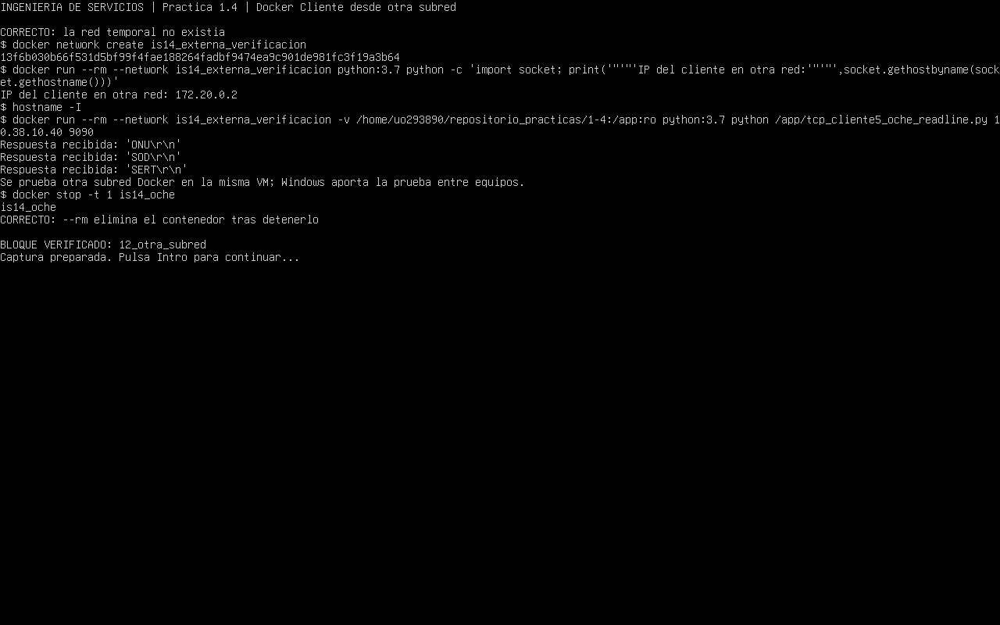

## Reproducción y conclusiones

Los programas de los ejercicios solo utilizan la biblioteca estándar de Python. Para ejecutar el verificador se necesita Linux con Python 3.8 o posterior, acceso a Docker, la imagen `python:3.7` y la red `pruebas`. Deben estar libres los puertos 20101 a 20111 y 9090, y los nombres temporales `is14_oche` e `is14_externa_verificacion`.

```bash
cd ~/repositorio_practicas/1-4
python3 verificar_practica.py
# Para detenerse después de cada bloque y tomar capturas
python3 verificar_practica.py --capturas
```

El modo ordinario verifica el servicio publicado desde Ubuntu. La prueba externa de Windows se activa con `--esperar-windows`: el verificador espera un registro nuevo `memoria/evidencias/11_cliente_windows.txt`. Ese archivo debe contener la salida real del cliente ejecutado desde Windows contra la IP actual de la VM y el puerto 9090. Las IP pueden cambiar entre sesiones.

Los trece bloques de esta ejecución constan como correctos en `resultados.json`. Los fallos del OCHE simplista son resultados esperados del experimento y están documentados, no se han ocultado. Se conserva el código original de los ejercicios 2, 5 y 7 y se añaden las versiones independientes que faltaban para reproducir los pasos intermedios del guion.

La comparación muestra que un tamaño fijo requiere que ambos extremos respeten ese tamaño, un delimitador exige buscarlo y conservar correctamente lo que se ha leído de más, y una longitud explícita permite recibir un cuerpo con contenido arbitrario. `makefile()` facilita el manejo de líneas con búfer; `struct` permite dar a una cabecera binaria un tamaño y un orden de bytes definidos.

Los servidores son secuenciales: atienden un cliente cada vez y una cola de `listen(5)` no equivale a cinco clientes atendidos simultáneamente. Las pruebas validan los intercambios del guion y la fragmentación controlada, no un comportamiento completo frente a entradas malformadas, clientes que no terminan los mensajes o errores de red arbitrarios.

**Referencia de trabajo:** guion «Sesión 1.4 Programación de red con python. TCP», Ingeniería de Servicios, curso 2026-2027, facilitado desde el campus virtual. Las capturas proceden de la consola de VirtualBox y sus PNG originales se conservan completos; el PDF muestra la zona con texto para facilitar la lectura.
