# Práctica 2.1

**Instalación y configuración de infraestructura software para la Web**

Ingeniería de Servicios

Alumno: **uo293890**

Ejecución y verificación: **16 y 17 de noviembre de 2026**

Se comprueba la infraestructura formada por Nginx, una aplicación Flask ejecutada con Gunicorn y MariaDB. La práctica pasa por la instalación de Nginx en Ubuntu, el despliegue con Docker, dos sitios estáticos, el proxy inverso y el almacenamiento persistente de la base de datos.

Esta memoria sigue los apartados del guion proporcionado, incluida su parte opcional de configuración de Nginx. Se han vuelto a ejecutar los experimentos y se incluyen capturas nuevas de la consola de la VM y del navegador de Windows. Las capturas antiguas del repositorio permanecen en el archivo histórico y no se utilizan aquí.

Los comandos principales se muestran con las rutas actuales del repositorio. Los registros íntegros están en `memoria/evidencias/`; las imágenes originales, en `memoria/capturas/`. Las capturas de consola pueden cortar visualmente órdenes largas en el borde derecho; sus transcripciones conservan las órdenes completas y las respuestas.

**Resultado:** los 13 bloques de verificación, desde `00_entorno` hasta `12_arquitectura`, han finalizado correctamente. Flask sigue siendo un ejemplo de saludo: la conexión de la aplicación con MariaDB corresponde a la sesión siguiente.

## 1. Entorno y organización

Se trabaja en la VM `IngenieriaServicios`, con Ubuntu 24.04.5 LTS, nombre `is-99`, Python 3.12.3 y Docker 29.8.0. La carpeta de esta sesión es `~/repositorio_practicas/practicas/2-1`. La red Docker `pruebas` utiliza la subred `172.18.0.0/16`.

El 16 de noviembre la IP de la VM era `10.38.10.40`; el día 17, al conectar el puente de VirtualBox al adaptador Ethernet activo, pasó a `192.168.0.139`. Por eso las capturas corresponden a dos direcciones. Los servicios internos se prueban también con `127.0.0.1`, que en los registros representa a la VM Ubuntu.

Las imágenes ya disponibles eran `nginx:latest` de 242 MB y `mariadb:latest` de 526 MB. Se reutilizaron esas imágenes locales; esta ejecución no demuestra una descarga nueva del registro ni que el tag local `latest` coincida con la versión más reciente publicada.

```bash
cd ~/repositorio_practicas/practicas/2-1
docker images
docker network inspect pruebas
```

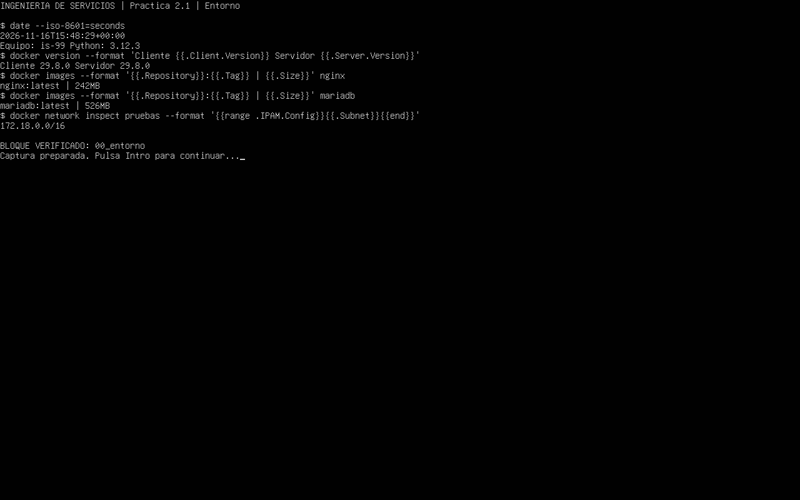

## 2. Nginx instalado con apt

Antes de instalar el servidor no había un servicio escuchando en el puerto 80. Se instaló Nginx con `apt`, obteniendo el paquete `1.24.0-2ubuntu7.19`. Después de la instalación, `systemctl is-active nginx` devolvió `active` y `ss` mostró escuchas en el puerto 80 para IPv4 e IPv6.

```bash
sudo apt install nginx
nginx -V
systemctl status nginx
ss -ltn '( sport = :80 )'
```

El binario instalado identifica su versión como `nginx/1.24.0 (Ubuntu)`. En `01_nginx_compilacion.txt` se conserva la salida de `nginx -V`, con las opciones y módulos de compilación, entre ellos SSL, HTTP/2 y soporte de módulos dinámicos.

La página oficial de descargas consultada el 17 de noviembre mostraba **1.30.6 como versión estable** y **1.31.8 como mainline**. La versión base del paquete Ubuntu es anterior; la distribución mantiene su propia revisión del paquete. La comparación procede de https://nginx.org/en/download.html.

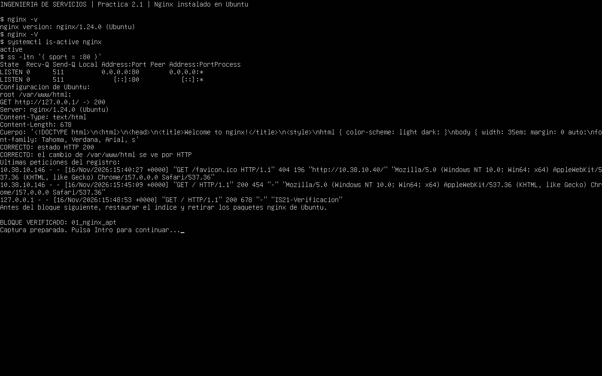

## 3. Directorio raíz y registro de accesos

En esta instalación de Ubuntu, la configuración efectiva indica `root /var/www/html;`. El archivo de bienvenida era `index.nginx-debian.html` dentro de ese directorio. La ruta `/usr/share/nginx/html` corresponde a la imagen Docker que se utiliza después, por lo que no debe suponerse que ambas instalaciones sirven la misma carpeta.

Se guardó una copia del índice de Ubuntu, se añadió el marcador `IS21_RAIZ_VAR_WWW` y se recargó el navegador. El cambio se vio por HTTP, confirmando qué archivo se estaba sirviendo. Después se restauró el índice original.

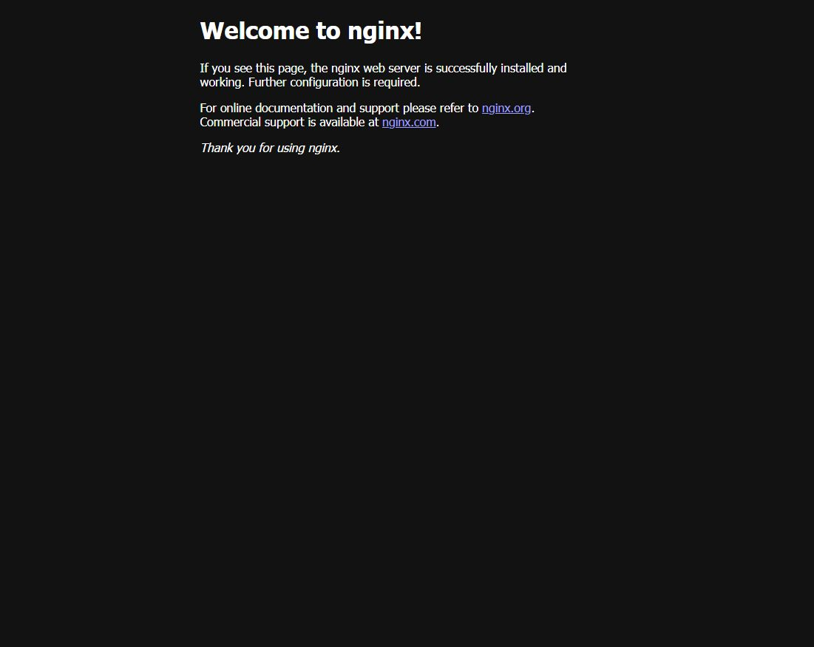

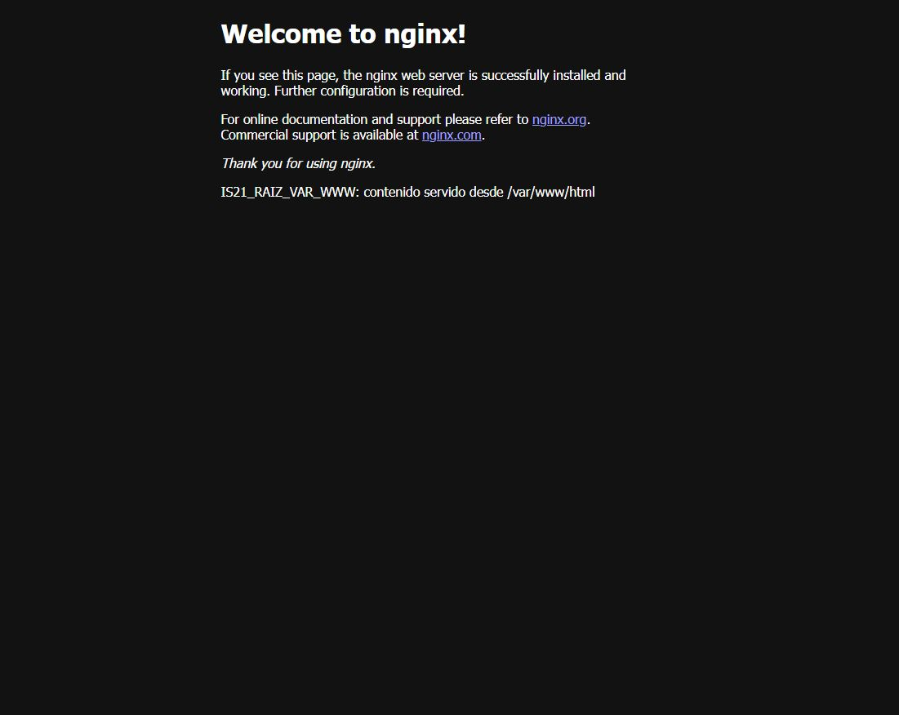

En `/var/log/nginx/access.log` quedaron peticiones `GET /` con estado 200, la IP del cliente y su `User-Agent`. También apareció `GET /favicon.ico` con 404: el navegador solicita ese recurso adicional aunque no exista. El registro de este experimento está en `01_nginx_apt.txt`.

## 4. Retirada de Nginx de Ubuntu

Antes de publicar el contenedor en el mismo puerto, se detuvo y retiró el servicio instalado con `apt`. Se eliminaron los paquetes `nginx` y `nginx-common` utilizados en este experimento. Se evitó aplicar una limpieza global que también proponía retirar paquetes ajenos a la práctica.

```bash
sudo systemctl stop nginx
sudo apt remove nginx nginx-common
ss -ltn '( sport = :80 )'
```

La comprobación posterior encontró el paquete `nginx` en estado `un`, sin instalar. La salida de `ss` quedó sin escuchas en el puerto 80 y una conexión a `127.0.0.1:80` no encontró servicio. Esto demuestra que el servidor de Ubuntu ya no ocupaba el puerto.

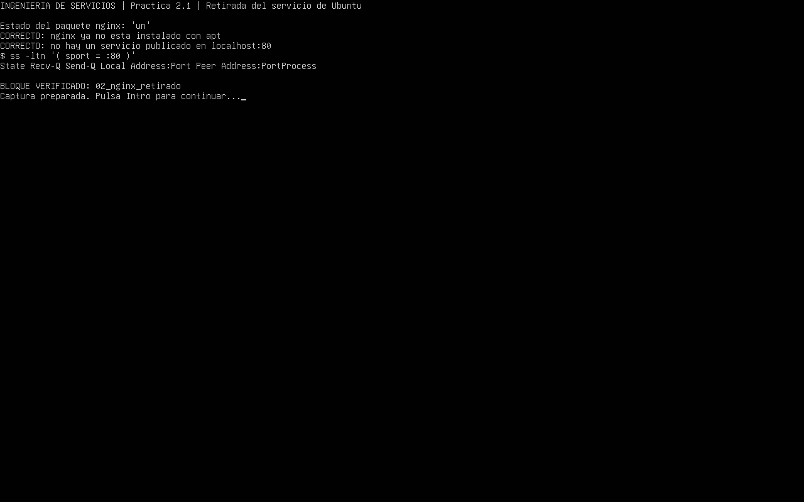

## 5. Nginx en Docker sin publicar puertos

Se lanzó la imagen local en un contenedor temporal llamado `is21_nginx_inicial` para distinguirlo de otros servicios de la VM.

```bash
docker run -d --rm --name is21_nginx_inicial --network pruebas nginx
docker inspect is21_nginx_inicial
```

`-d` deja el proceso en segundo plano; `--rm` elimina el contenedor cuando termina; `--name` establece su nombre y `--network pruebas` lo conecta a la red del laboratorio. No se emplea `-p`: Nginx escucha en el puerto 80 del contenedor, sin publicarlo en el puerto 80 de Ubuntu.

La IP asignada fue `172.18.0.2`. Desde Ubuntu se recibieron por HTTP tanto `/` como `/50x.html`. Se conservó el índice original en `evidencias/nginx_index_original.html` y la página de error en `html/50x.html`. La configuración del contenedor indicó `root /usr/share/nginx/html;` y su binario mostró Nginx **1.31.6**.

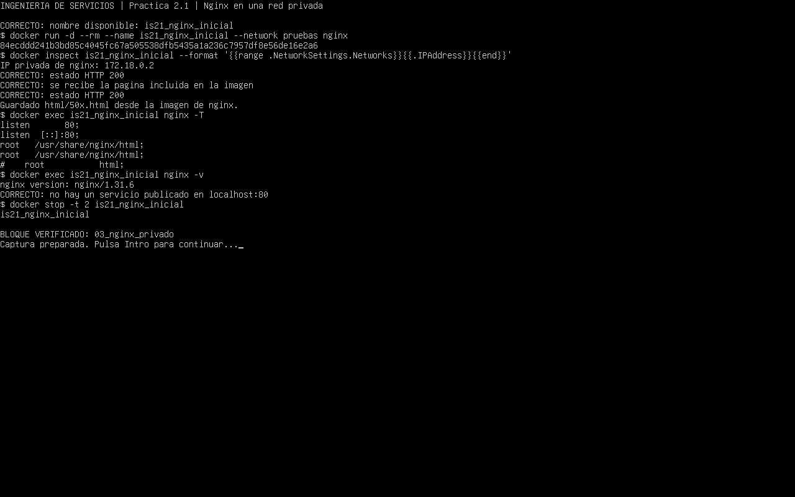

## 6. Dos sitios estáticos y script de lanzamiento

El ejercicio 1 ya estaba implementado. Se ejecutó `bash lanzar_nginx.sh` desde la carpeta de la práctica. El contenedor `servidor_nginx` monta `html` y `html2` en `/usr/share/nginx/html` y `/usr/share/nginx/html2`, la carpeta `sitios_nginx` en `/etc/nginx/conf.d` y `nginx.conf` en `/etc/nginx/nginx.conf`.

El script publica `80:80` y `81:81`. El archivo `default.conf` atiende el puerto 80 y `sitio2.conf` el 81. Sus índices son distintos, lo que permite comprobar la selección del sitio desde Windows.


La directiva `index` selecciona el índice al pedir un directorio. `try_files $uri $uri/ =404;` busca primero el recurso exacto, después un directorio y, si ninguno existe, devuelve 404. Se comprobó `/noexisto`, además de los dos índices y `/50x.html`.

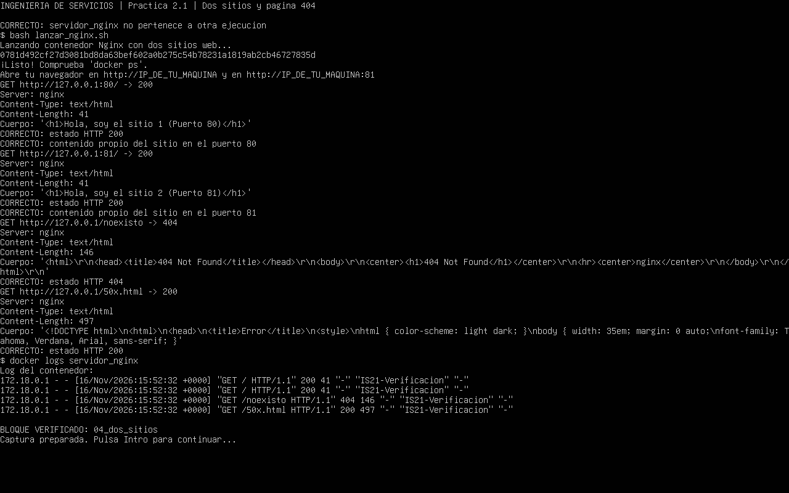

Las peticiones se consultan mediante `docker logs servidor_nginx`: la imagen dirige los registros a la salida del contenedor y Docker conserva esa salida aunque se lance con `-d`.

## 7. Configuración opcional de Nginx

El archivo global conserva una sola declaración de `keepalive_timeout`, cambiada de 65 a 10 segundos para coincidir con el guion. La configuración efectiva incluye:

```nginx
server_tokens off;
client_max_body_size 4096k;
client_header_timeout 10;
client_body_timeout 10;
keepalive_timeout 10;
send_timeout 10;
```

`nginx -t` validó la sintaxis. `nginx -T` mostró los valores cargados. La respuesta 404 ya no incluyó la versión en la cabecera `Server`, que quedó como `nginx`. Una solicitud con `Content-Length` superior a 4 MiB recibió **413**, verificando el límite de cuerpo configurado.

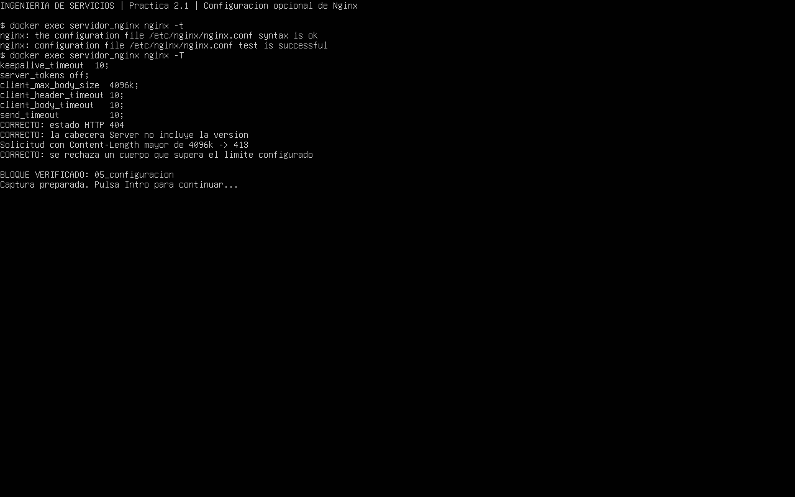

Los tiempos no son todos plazos totales de una petición: `client_body_timeout` mide el intervalo entre lecturas del cuerpo y `send_timeout`, entre escrituras de la respuesta; `keepalive_timeout` limita la espera de una conexión persistente inactiva. No se midieron experimentalmente esos tiempos. Referencia: https://nginx.org/en/docs/http/ngx_http_core_module.html. HTTPS queda fuera del alcance de este guion.

## 8. Flask y entorno virtual

Se reutilizó el entorno `~/flaskenv`, que ya tenía las dependencias instaladas. No hizo falta reinstalarlas. Se verificó la importación de Flask **3.1.3** y su ruta dentro de `flaskenv/lib/python3.12/site-packages`, independiente de los paquetes globales del sistema.

Para crear un entorno equivalente desde cero, los comandos del guion son `python3 -m venv ~/flaskenv`, `source ~/flaskenv/bin/activate` y `pip install flask gunicorn`. El entorno virtual permanece fuera del control de versiones.

El archivo original `hola_flask/hola_flask.py` ya asociaba `/` a una función que devuelve `<i>¡Hola Flask en cursiva!</i>`. No fue necesario modificarlo. Se ejecutó desde su carpeta con el servidor de desarrollo:

```bash
~/flaskenv/bin/flask --app hola_flask run --host=0.0.0.0 --port=5000 --no-reload
```

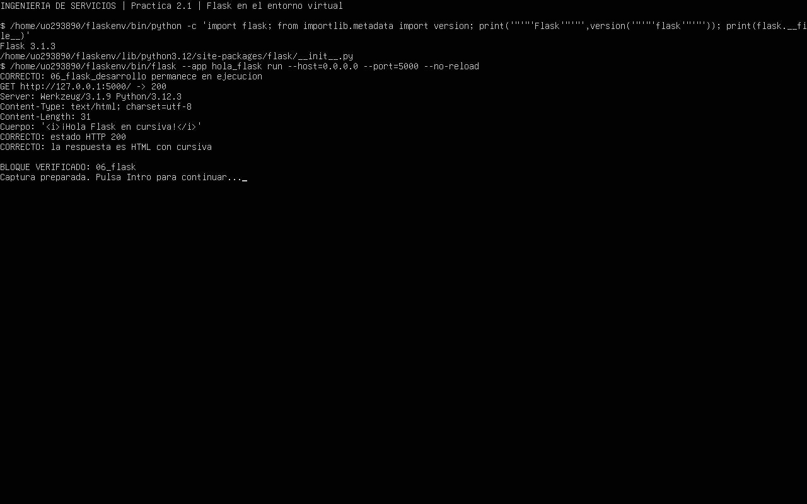


La respuesta fue HTTP 200, `Server: Werkzeug/3.1.9 Python/3.12.3`, `Content-Type: text/html; charset=utf-8` y `Content-Length: 31`. La longitud cuenta bytes, incluidos los caracteres codificados en UTF-8. Estas cabeceras se registraron con el cliente HTTP de verificación, además de comprobar el resultado visual en el navegador.

## 9. Gunicorn y cuatro workers

Se detuvo el servidor de desarrollo para liberar el puerto 5000 y se lanzó Gunicorn, manteniendo el mismo código de la aplicación:

```bash
~/flaskenv/bin/gunicorn -b 0.0.0.0:5000 -w 4 hola_flask:app
```

`-b` indica la dirección y puerto de escucha; `-w 4`, los cuatro procesos trabajadores; `hola_flask:app`, el módulo y el objeto de aplicación WSGI. El proceso maestro tuvo cuatro hijos, comprobados con `ps --ppid`. La respuesta mantuvo el saludo y cambió la cabecera a **Server: gunicorn**.

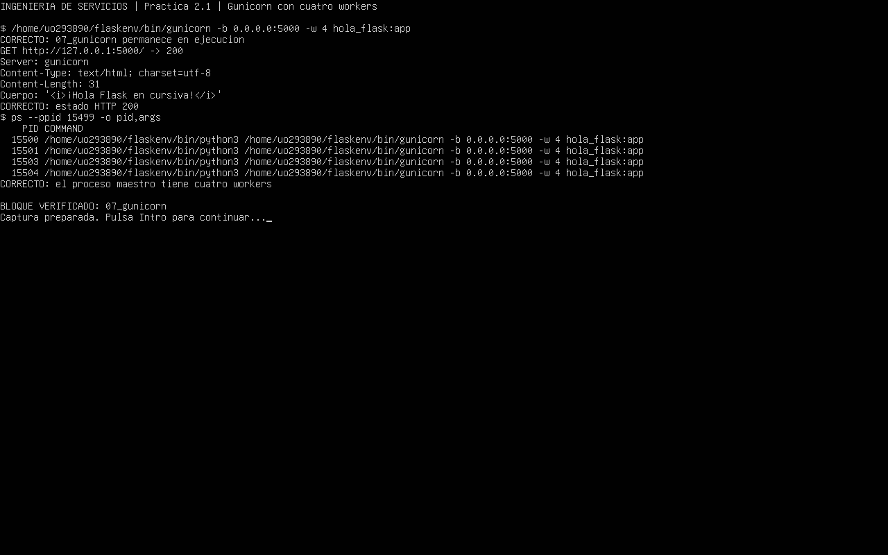


El servidor de desarrollo de Flask se reserva para desarrollo. No se asume que las versiones actuales atiendan siempre un único cliente sin hilos. Gunicorn ofrece el despliegue WSGI utilizado en esta práctica: recibe HTTP y comunica la solicitud con Flask mediante WSGI. Referencia: https://flask.palletsprojects.com/en/stable/deploying/.

## 10. Construcción de la imagen de Flask

El Dockerfile existente está en la raíz de `2-1`, mientras que el módulo está dentro de `hola_flask`. Su instrucción `COPY hola_flask.py /app` fallaba desde ese contexto. Se corrigió únicamente esa ruta a `COPY hola_flask/hola_flask.py /app/`.

```dockerfile
FROM python:3.7
RUN pip install flask gunicorn
RUN mkdir /app
COPY hola_flask/hola_flask.py /app/
WORKDIR /app
EXPOSE 5000
CMD ["/usr/local/bin/gunicorn", "-b", "0.0.0.0:5000", "-w", "4", "hola_flask:app"]
```

Se construyó desde la carpeta de la práctica con `docker build -t gunicornflask:1.0 .`. La segunda construcción reutilizó **cuatro pasos CACHED**. Las salidas completas están en `08_build_detalle.txt` y `08_build_cache.txt`.

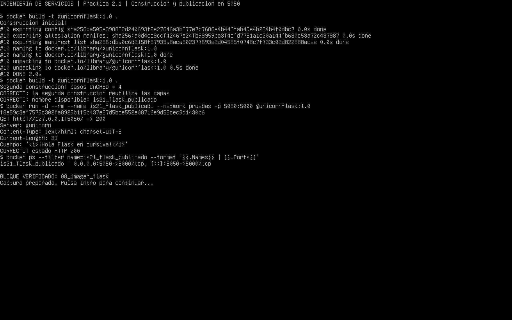


`-p 5050:5000` publica el puerto 5000 del contenedor en el 5050 de Ubuntu. `EXPOSE 5000` solo documenta el puerto; no lo publica por sí mismo. La cabecera sigue siendo `Server: gunicorn`. Se conserva la base Python 3.7 del ejercicio; en esta imagen se resolvieron Flask 2.2.5 y Gunicorn 23.0.0, distintos del entorno de Ubuntu. El Dockerfile no fija sus versiones. Referencia: https://docs.docker.com/reference/dockerfile/.

## 11. Nginx como proxy inverso

Se detuvo el contenedor publicado en 5050 y se lanzó `hola-flask` en `pruebas`, sin `-p`. Nginx y Gunicorn comparten esa red, pero solo Nginx publica los puertos de acceso web de la VM.

```bash
docker run -d --rm --name hola-flask --network pruebas gunicornflask:1.0
```

La configuración original ya contenía la regla del guion:

```nginx
location ~ ^/hola(/?)(.*) {
    resolver 127.0.0.11;
    proxy_pass http://hola-flask:5000/$2;
}
```

El DNS integrado de Docker resuelve `hola-flask`. La segunda captura de la expresión regular se incorpora a la ruta enviada al servidor interno: `/hola` y `/hola/` llegan como `/`, mientras que `/hola/mundo` llega como `/mundo`.

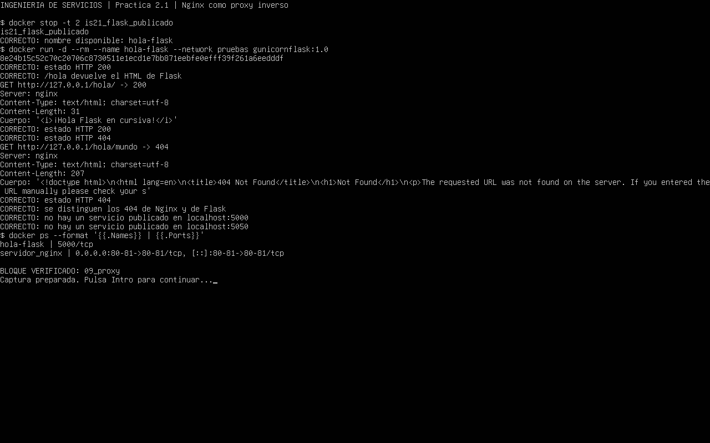


Se verificaron respuestas 200 para las dos variantes del saludo y la ausencia de servicios publicados en `127.0.0.1:5000` y `:5050`. La respuesta exterior utiliza `Server: nginx`. El tramo interno Nginx-Gunicorn continúa usando HTTP; WSGI conecta Gunicorn con la aplicación Python.

## 12. Comparación de errores 404

Al solicitar `/noexisto`, Nginx aplica la regla estática y devuelve su propia página 404. Al pedir `/hola/mundo`, la solicitud llega a Flask como `/mundo`; la aplicación no define esa ruta y genera otra página 404. El código de estado coincide, pero la procedencia y el cuerpo son distintos.


El verificador compara los cuerpos: uno contiene la identificación de Nginx y el otro la explicación de Flask de que la ruta no existe. Aunque el error lo genere Flask, la respuesta atraviesa el proxy y conserva la cabecera exterior `Server: nginx`. Por eso la cabecera por sí sola no permite atribuir el origen de este 404.

La captura `04_error404_nginx_web.jpg` conserva además el error del sitio estático obtenido el primer día; las dos figuras anteriores corresponden a la comprobación final del proxy.

## 13. MariaDB y cliente en otra instancia

Se creó un servidor temporal `is21_mariadb_temporal` con la imagen local de MariaDB, conectado a `pruebas` y sin publicar el puerto 3306. La variable `MARIADB_ROOT_PASSWORD` inicializa la clave de laboratorio `claveroot`, indicada en el guion.

```bash
docker run -d --rm --name is21_mariadb_temporal --network pruebas -e MARIADB_ROOT_PASSWORD=claveroot mariadb
docker run --rm --network pruebas -e MYSQL_PWD=claveroot mariadb mariadb --host is21_mariadb_temporal --user root --execute 'SHOW DATABASES;'
```

El segundo contenedor ejecuta el cliente, no otro servidor de base de datos. Se usa el nombre DNS del servidor para conectar. `SELECT VERSION()` devolvió **13.0.2-MariaDB-ubu2604**; `SHOW DATABASES` enumeró `information_schema`, `mysql`, `performance_schema` y `sys`. `docker top` mostró el proceso `mariadbd` y se confirmó que el puerto 3306 de Ubuntu no estaba publicado.

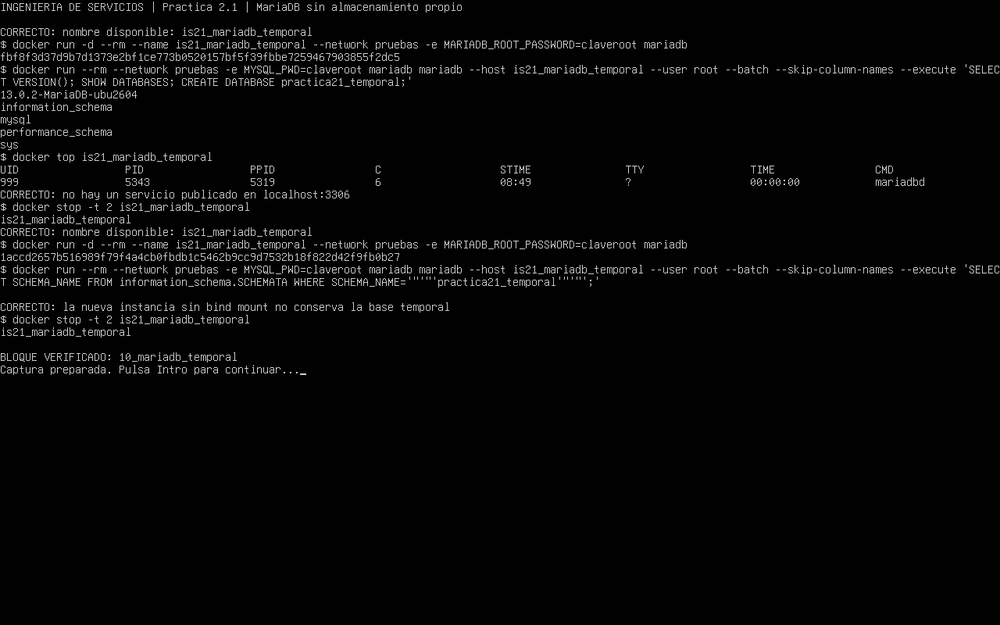

Se creó `practica21_temporal`, se detuvo y eliminó el contenedor, y se creó otro sin reutilizar su almacenamiento. Una consulta a `information_schema.SCHEMATA` ya no encontró esa base. El experimento demuestra que recrear así el servidor no recupera los datos del anterior; detener un contenedor sin eliminarlo es un caso diferente.

## 14. Persistencia de MariaDB

Se repitió el despliegue con `is21_mariadb_persistente`, añadiendo el alias de red `mariadb` y un bind mount de `basedatos_verificacion` sobre `/var/lib/mysql`. Se eligió una carpeta exclusiva de esta prueba para conservar intactas las bases de otras sesiones.

```bash
docker run -d --rm --name is21_mariadb_persistente --network pruebas --network-alias mariadb -e MARIADB_ROOT_PASSWORD=claveroot -v "$(pwd)/basedatos_verificacion:/var/lib/mysql" mariadb
```

Desde otro contenedor cliente se creó la base `practica21`, la tabla `evidencia` y la fila de identificador 1 con el texto **IS21_20261117_085040**. Se comprobó con `docker inspect` que el montaje era de tipo `bind` y apuntaba al directorio esperado.

Después se detuvo y eliminó el contenedor y se creó otro con la misma carpeta montada. La consulta `SELECT * FROM practica21.evidencia;` devolvió exactamente la misma fila. Se verifica así la persistencia mediante datos concretos y un cambio de instancia del servidor.

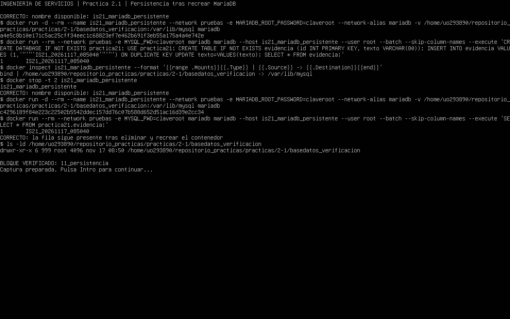

La carpeta se creó con propietario numérico 999 y permisos locales del servidor. Está excluida de Git mediante `basedatos*/`; se versionan el procedimiento y sus evidencias, sin subir los archivos internos de la base. La configuración de MariaDB permanece con los valores de la imagen. Referencia de inicialización y almacenamiento: https://hub.docker.com/_/mariadb.

## 15. Arquitectura final comprobada

Al terminar quedan activos tres contenedores: `servidor_nginx`, `hola-flask` e `is21_mariadb_persistente`. Los dos primeros sirven los contenidos estáticos y dinámicos; el tercero conserva los datos de la prueba. Todos pertenecen a `pruebas`.

```text
Windows -> Ubuntu:80 -> Nginx -> ficheros de html/
                            -> /hola -> hola-flask:5000 -> Gunicorn -> Flask
Windows -> Ubuntu:81 -> Nginx -> ficheros de html2/
Cliente SQL en pruebas -> mariadb:3306 -> basedatos_verificacion/
```

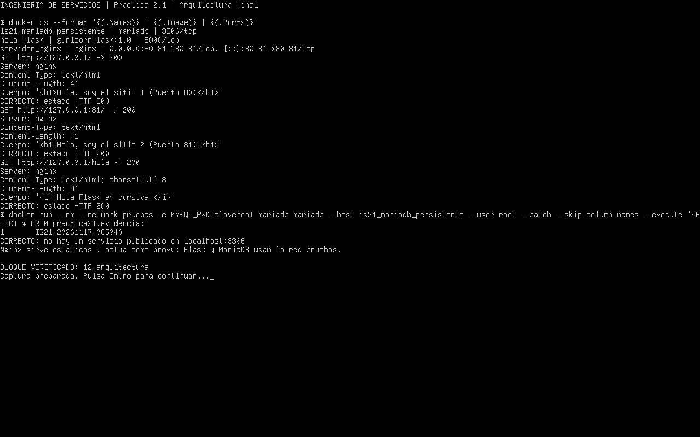

La salida de `docker ps` muestra la publicación de 80 y 81 para Nginx. En los otros dos contenedores, `5000/tcp` y `3306/tcp` indican puertos internos, sin una asignación a puertos de Ubuntu. Se volvió a comprobar la respuesta de `/`, `:81/` y `/hola`, la fila persistente y el cierre del puerto 3306 del anfitrión.

Flask todavía no utiliza la base de datos: el enlace SQL del esquema representa el cliente de prueba. La siguiente sesión añadirá una aplicación que sí la use. Los contenedores se han dejado activos para revisión; se lanzan con `--rm` y habrá que recrearlos si se detienen, reutilizando el directorio persistente de MariaDB.

## 16. Cambios y reproducción

De los archivos originales de esta sesión solo se corrigieron la ruta `COPY` del Dockerfile y el valor de `keepalive_timeout` en `nginx.conf`, junto con su comentario. Se añadió `html/50x.html`, recuperado de la imagen. El saludo Flask, los índices, las configuraciones de los dos sitios y el script de lanzamiento conservan su comportamiento original.

Se añadieron esta memoria, sus evidencias, el generador del PDF y `verificar_practica.py`. El archivo `.dockerignore` limita el contexto de construcción al módulo de la aplicación y al Dockerfile, evitando enviar bases de datos, capturas y documentos al constructor. La reorganización general coloca cada sesión en `practicas/<sesion>`, archiva las capturas anteriores y excluye cachés, entornos y datos generados. Se preservaron los cambios locales pendientes de las otras prácticas en la VM.

El verificador requiere Docker accesible, las imágenes del laboratorio, la red `pruebas` y Flask/Gunicorn en `~/flaskenv`. Debe ejecutarse desde la VM y con los nombres de sus contenedores de prueba disponibles. No instala automáticamente dependencias ni retira por sí solo el paquete de Ubuntu.

```bash
cd ~/repositorio_practicas/practicas/2-1
python3 verificar_practica.py --capturas --mantener
```

`--capturas` pausa al terminar cada bloque para capturar la consola real; `--mantener` deja los servicios finales activos al terminar correctamente. Sin él se retiran los contenedores creados por esa ejecución. `--apt` incorpora las fases de instalación y retirada de Ubuntu, que requieren intervención administrativa entre bloques. `--desde IDENTIFICADOR` reanuda desde un bloque, siempre que se preparen los servicios previos que ese bloque necesita.

El registro `resultados.json` reúne los 13 bloques correctos de los dos días. Las pruebas automáticas HTTP y SQL complementan las capturas del navegador. No se presenta como realizada una inspección manual de cabeceras en DevTools: las cabeceras citadas proceden de las peticiones HTTP registradas.
