# Práctica 2.2

**Aplicaciones Web y el protocolo HTTP**

Ingeniería de Servicios

Alumno: **uo293890**

Ejecución y comprobaciones: **17 de noviembre de 2026**

Se verifica y completa la aplicación Amigos del guion: almacenamiento de nombres y coordenadas en MariaDB, interfaz HTML con formularios, API REST en JSON y despliegue con Nginx y Gunicorn. Se incluye el ejercicio adicional de dispositivos, sus migraciones y la limpieza final de los valores de prueba.

La aplicación ya tenía gran parte del trabajo implementado. Se parte de ese código y de los cinco archivos modificados que estaban pendientes en la VM. Se incorporan las correcciones necesarias para conservar la tabla existente, aplicar la migración y obtener los errores HTTP especificados por el guion.

Se ha utilizado una **base independiente de verificación**, sin modificar las carpetas de datos de las prácticas anteriores. Todas las capturas son nuevas, tomadas de la consola real de VirtualBox y del navegador de Windows. Los archivos completos de ejecución están en `memoria/evidencias/` y las imágenes originales en `memoria/capturas/`.

**Resultado:** los 13 bloques del verificador finalizaron correctamente. También se reconstruyó y comprobó la versión 1.0 para compararla con la 2.0 final. Las vistas HTML y JSON funcionan a través del puerto 80; MariaDB y Gunicorn no publican sus puertos en Ubuntu.

## 1. Entorno de trabajo

La VM `IngenieriaServicios` ejecuta Ubuntu 24.04.5 LTS, con nombre `is-99`, Python 3.12.3 y Docker 29.8.0. Durante esta ejecución su dirección fue `10.38.16.154`. El adaptador puente de VirtualBox se conectó a la Wi-Fi activa del equipo para recuperar SSH y el acceso desde Windows.

Se reutilizó `~/flaskenv`, que ya contenía Flask 3.1.3, Flask-SQLAlchemy 3.1.1, Flask-Migrate 4.0.1, PyMySQL 1.2.3, HTTPie 3.2.4 y Gunicorn 26.2.0. Estas son las versiones del entorno de Ubuntu, no las de la imagen Python 3.7 que se utiliza después.

```bash
cd ~/repositorio_practicas/practicas/2-2
source ~/flaskenv/bin/activate
docker ps
```

Al comenzar no había contenedores activos. Se conservaron los contenedores detenidos y las imágenes de otras sesiones. No fue necesario volver a instalar los paquetes del entorno virtual ni eliminar servicios ajenos a esta práctica.

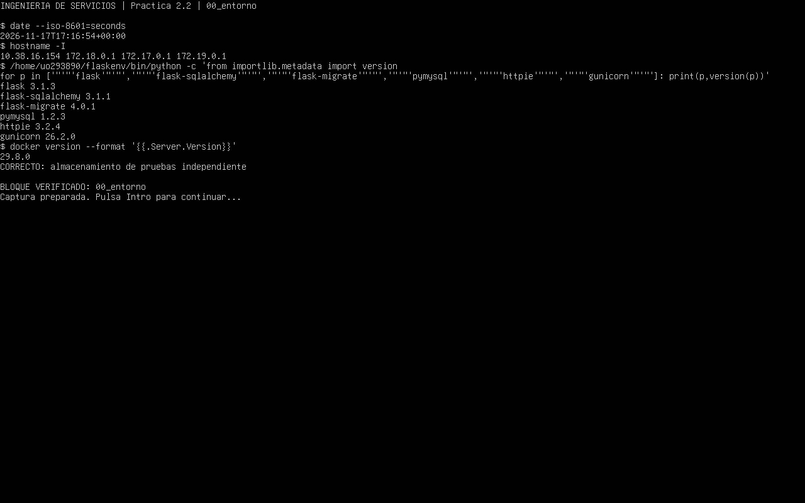

## 2. MariaDB y base de datos vacía

Se creó el contenedor `basedatos` en la red `pruebas`, inicializando `amigosdb`, el usuario `amigosuser` y la contraseña de laboratorio `amigospass`. La clave de administración fue la indicada por el guion, `claveroot`.

```bash
docker run -d --rm --name basedatos --network pruebas \
  -e MYSQL_ROOT_PASSWORD=claveroot -e MYSQL_USER=amigosuser \
  -e MYSQL_DATABASE=amigosdb -e MYSQL_PASSWORD=amigospass \
  -v "$(pwd)/basedatos_verificacion:/var/lib/mysql" mariadb
```

Se eligió `basedatos_verificacion` en lugar de reutilizar las carpetas `basedatos` anteriores. El verificador comprueba el montaje antes de modificar datos o ejecutar el downgrade opcional.

Un contenedor cliente separado, también en `pruebas`, ejecutó `SHOW TABLES;` con las credenciales del usuario de la aplicación. El resultado vacío confirmó que se partía de una base nueva. No se publicó `3306`: el servidor SQL solo es accesible por la red interna y, desde Ubuntu, por la IP del contenedor.

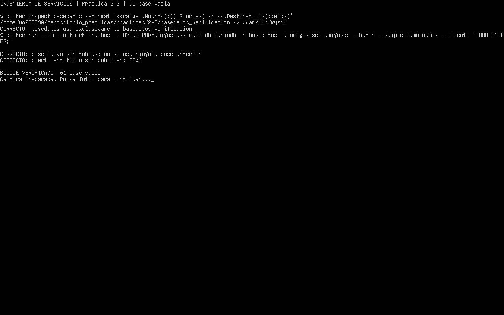

## 3. Modelo, vista y controlador

El modelo `Amigo` describe los datos persistentes; las plantillas Jinja construyen las páginas HTML; las funciones de los blueprints reciben peticiones, consultan o modifican el modelo y generan una respuesta. Las dos interfaces comparten el mismo objeto `db` y la misma base de datos.

```text
amigos/
  lanzar.py                 objeto app para Flask y Gunicorn
  config.py                 development / production
  app/
    __init__.py             factoria create_app y registro de blueprints
    models.py               modelo Amigo
    validacion.py           comprobaciones de campos y commit
    html/views.py           formularios y tabla HTML
    api/views.py            recursos JSON
    templates/              tabla y formulario Jinja
  migrations/               historial de cambios de esquema
  instance/                 configuracion local, excluida de Git
```

`lanzar.py` toma `DEPLOYMENT_MODE`, con `production` como valor predeterminado, y llama a `create_app`. La factoría carga la configuración, inicializa SQLAlchemy y Flask-Migrate, y monta los blueprints en `/html` y `/api`.

Para ejecutar un clon sin archivos locales, la factoría admite directamente `DATABASE_URI`. Si hay un `instance/config.py`, puede seguir aportando configuración; la variable de entorno tiene prioridad. No se ha subido ese archivo local ni se incorpora a la imagen Docker.

Desde Ubuntu se utiliza la IP de `basedatos` en la URI. Dentro de Docker se usa el nombre DNS `basedatos`, porque los contenedores están en la misma red `pruebas`. En ambos casos, el driver es `mysql+pymysql`.

## 4. Modelo inicial y primera migración

La migración original `e753fcc1a838` define la tabla **amigos**, con `id` entero autoincrementado y clave primaria, `name` único de hasta 32 caracteres y las coordenadas `lati` y `longi` almacenadas como cadenas de hasta 32 caracteres.

En el modelo pendiente de la VM había desaparecido `__tablename__`: SQLAlchemy deducía entonces `amigo`, que no coincide con `amigos`. Se restauró el nombre explícito y la definición original de esas columnas, añadiendo `device` sin reemplazar la tabla.

Se aplicó la migración inicial sobre la base vacía. `SHOW TABLES` mostró `amigos` y `alembic_version`; `DESCRIBE amigos` permitió comprobar tipos, nulabilidad y claves. Se realizó después el experimento opcional de downgrade y upgrade, **todavía sin registros**, para no perder información.

```bash
~/flaskenv/bin/flask --app lanzar db upgrade e753fcc1a838
~/flaskenv/bin/flask --app lanzar db downgrade base
~/flaskenv/bin/flask --app lanzar db upgrade e753fcc1a838
```

Finalmente se insertaron Manolito y Luis desde Python con SQLAlchemy y se consultaron sus identificadores y coordenadas. La inserción se confirmó con `db.session.commit()`; preparar una operación en la sesión no equivale a confirmarla en la base de datos.

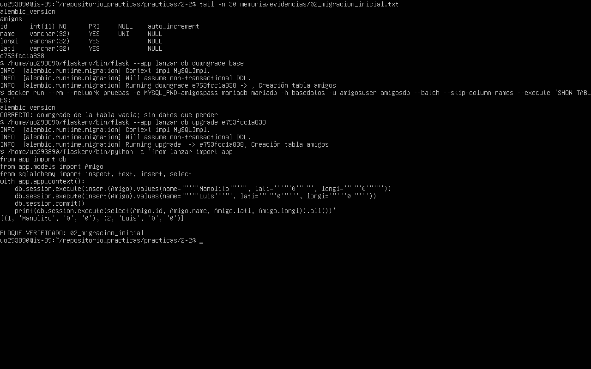

## 5. Migración del campo device

Se añadió al modelo `device = db.Column(db.Text, nullable=True)`. Se generó la revisión **a9d678823200**, cuya revisión anterior es `e753fcc1a838`. Su upgrade añade la columna `device` a `amigos`; no crea una tabla alternativa ni borra la existente.

```bash
~/flaskenv/bin/flask --app lanzar db migrate -m 'anadir device a amigos'
~/flaskenv/bin/flask --app lanzar db upgrade
~/flaskenv/bin/flask --app lanzar db current
```

Tras el upgrade, Manolito y Luis seguían presentes y ambos tenían `device is None` en Python, correspondiente a SQL NULL. Se verificó el tipo TEXT nullable y que la revisión aplicada era `a9d678823200 (head)`. La comparación de los metadatos con el esquema mediante Alembic devolvió una lista vacía de diferencias.

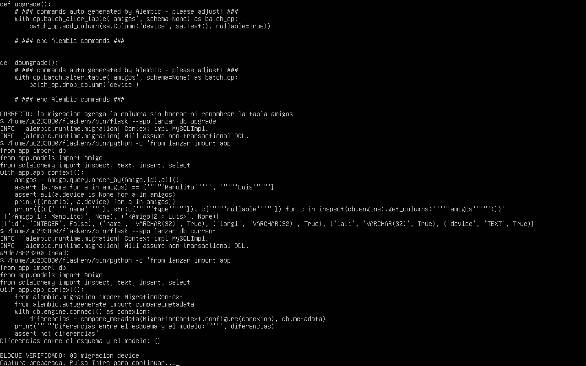

También se corrigió `migrations/env.py`: se utiliza `render_as_string(hide_password=False)` al entregar la URL al motor de migraciones. Con SQLAlchemy 2, convertir la URL mediante `str()` oculta la contraseña y no sirve como URL de conexión efectiva. La clave no se añade por ello al repositorio: procede de la configuración de ejecución.

No se ejecuta de nuevo `flask db init`, porque el repositorio ya tiene su historial de migraciones. Las migraciones generadas se incluyen en Git, como indica la documentación de Flask-Migrate: https://flask-migrate.readthedocs.io/en/latest/.

## 6. Servidor de desarrollo y blueprints

Se lanzó la aplicación desde el entorno virtual de Ubuntu con `DEPLOYMENT_MODE=development`. Se desactivaron el recargador y el depurador interactivo para mantener una única instancia durante las pruebas y capturas.

```bash
cd amigos
~/flaskenv/bin/flask --app lanzar run --host=0.0.0.0 --no-reload --no-debugger
```

La ruta `/html/amigos` devolvió HTML y `/api/amigos`, JSON. La tabla inicial presentó los dos amigos insertados desde Python y la columna de dispositivo vacía. El registro de rutas confirma que ambos blueprints pertenecen a la misma aplicación.

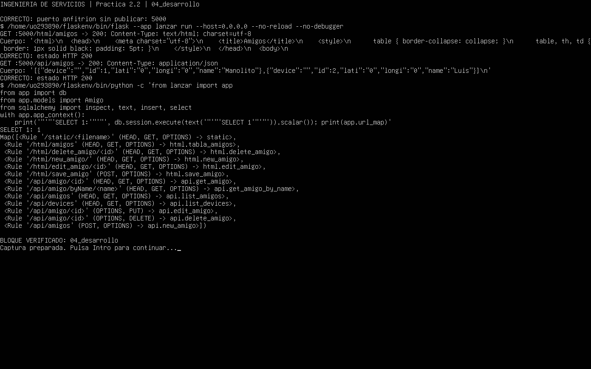

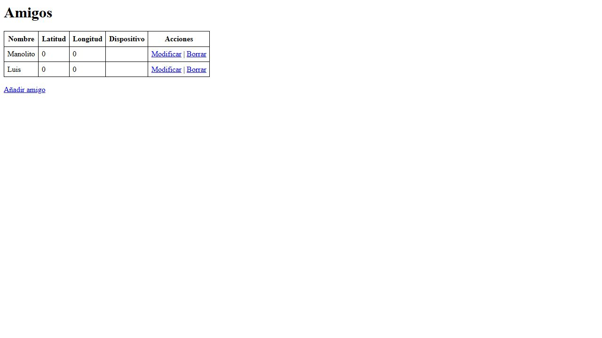

Se ejecutó además `SELECT 1` a través de la sesión de SQLAlchemy. Así se comprueba una conexión real con MariaDB; crear y configurar el objeto Flask, por sí solo, no demuestra que se haya realizado ya una consulta al servidor.

## 7. Alta desde un formulario HTML

La tabla contiene los enlaces «Modificar», «Borrar» y «Añadir amigo». Las plantillas conservan el estilo sencillo del ejercicio, con bordes y separación entre celdas.

Al pulsar «Añadir amigo» se solicita `/html/new_amigo/` mediante GET. La misma plantilla sirve para un alta y una edición: el campo oculto `id` está vacío al crear un amigo y contiene su identificador cuando se edita uno existente.

Se introdujo **BertaLaboratorio**, con latitud `43.36`, longitud `-5.85` y dispositivo `dispositivo-navegador`, desde el navegador real. Al enviar el formulario, los campos llegan al controlador en `request.form` y la aplicación crea el registro mediante SQLAlchemy.

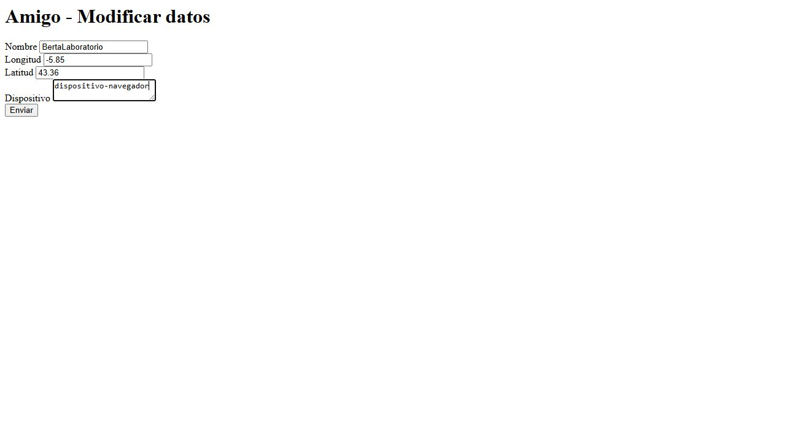

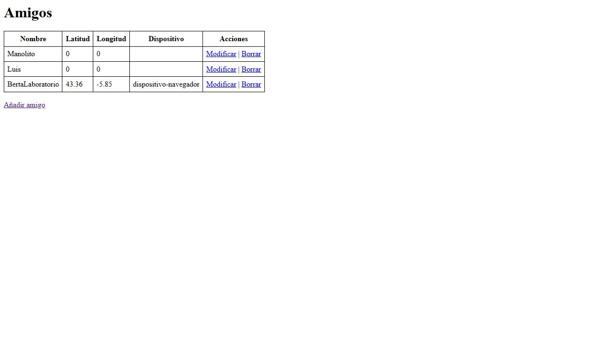

Las pruebas HTTP complementarias verifican que el nombre es obligatorio y que un duplicado devuelve 422. El nombre único se valida antes de guardar; si una restricción de la base de datos rechaza el commit, se hace rollback para dejar la sesión utilizable.

## 8. Edición, valor vacío y borrado en HTML

Se abrió la edición de BertaLaboratorio desde su enlace de la tabla. El formulario contenía los datos guardados. Se cambió la latitud a `43.37` y se vació el dispositivo, confirmando que el servidor conserva una cadena vacía en lugar de ignorar ese cambio.

El dispositivo se edita con un `textarea` que admite hasta 4096 caracteres. La plantilla usa la expresión `amigo.device or ''`, evitando que un NULL se muestre como el texto literal «None» y después se guarde accidentalmente como tal.

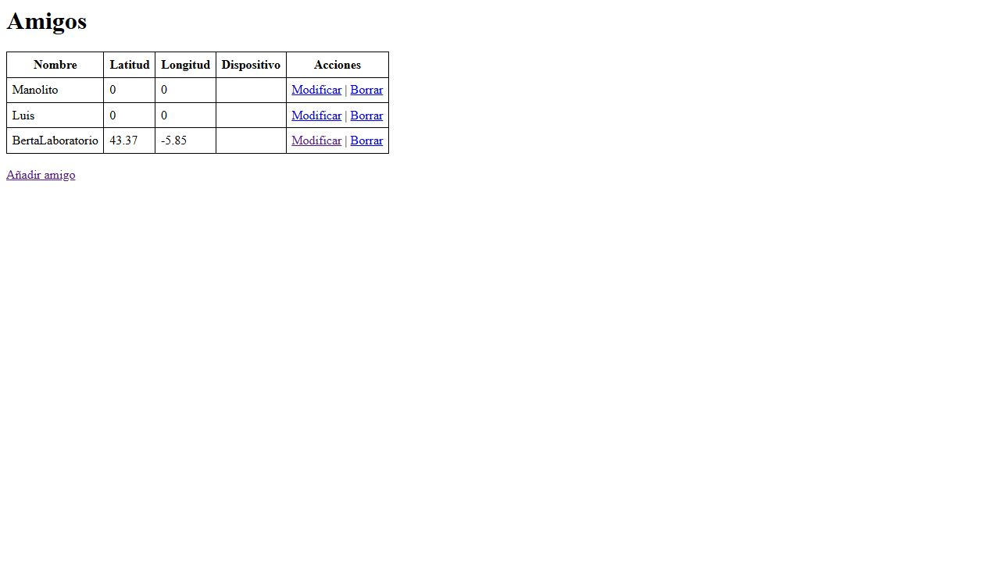

Después se utilizó «Borrar» sobre ese mismo registro de prueba. La tabla volvió a contener solo Manolito y Luis. Se eliminó únicamente el amigo creado para esta comprobación visual, dentro de la base independiente.

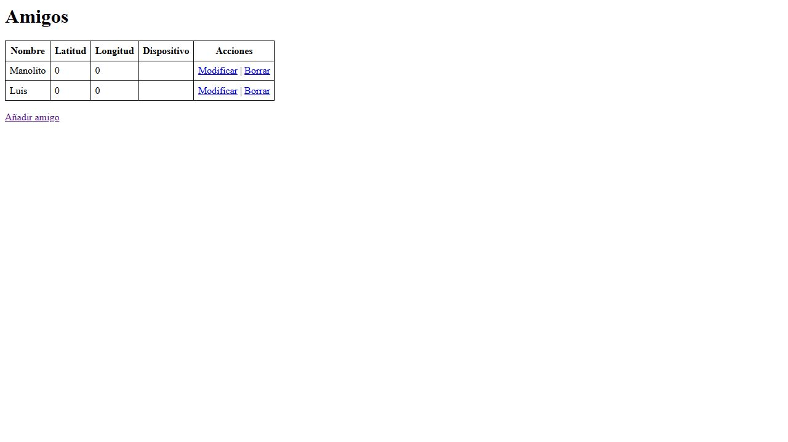

Los datos de la aplicación se modifican a través del controlador, no desde la plantilla. Jinja muestra los valores que recibe; SQLAlchemy y la sesión se ocupan de persistirlos.

## 9. HTTP de los formularios y redirecciones

El alta y la modificación usan `POST /html/save_amigo`. La respuesta es **302** y contiene `Location: /html/amigos`. El navegador sigue esa redirección con una nueva petición GET y muestra la tabla actualizada. El enlace de borrado del diseño del guion sigue el mismo patrón de redirección tras ejecutar la operación.

Las pruebas usan también un cliente HTTP que no sigue automáticamente las redirecciones. Esto permite observar el 302 original y su cabecera `Location`, en lugar de ver únicamente el 200 de la tabla final.

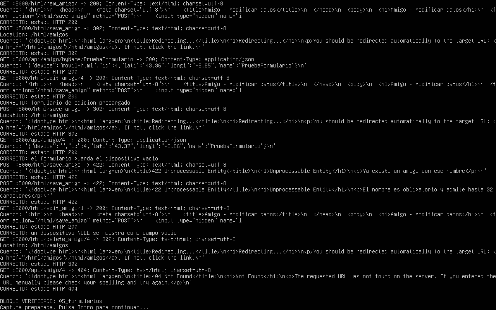

En el guion, el borrado de la interfaz HTML se implementa con GET y un enlace. Se conserva ese contrato del laboratorio; la API separada dispone del verbo DELETE. Un formulario HTML nativo usa GET o POST, aunque un navegador sí puede emitir otros verbos si una aplicación emplea JavaScript.

Se comprobó además el formulario de Manolito, cuyo dispositivo era SQL NULL en este punto, para verificar que no contenía `value="None"` ni el texto «None» en el área de dispositivo. Un identificador inexistente devuelve 404.

Las capturas prueban el comportamiento visual; los códigos, cabeceras y cuerpos citados proceden de los registros HTTP del verificador. No se presentan como capturas de una inspección manual de DevTools.

## 10. Lecturas de la API REST

El blueprint `/api` comparte el modelo con `/html`, pero utiliza `jsonify` para generar las respuestas. Se comprobó `Content-Type: application/json` en las lecturas correctas.

```text
GET /api/amigos                   lista de amigos
GET /api/amigo/1                  amigo por identificador
GET /api/amigo/byName/manolito     amigo por nombre
```

La consulta por nombre encontró a Manolito aun utilizando minúsculas, de acuerdo con la comparación de cadenas de esta base. Las búsquedas de un identificador o nombre inexistentes devolvieron 404. Los errores generados con `abort` conservan la página HTML de error de Flask; las respuestas correctas de la API son JSON.

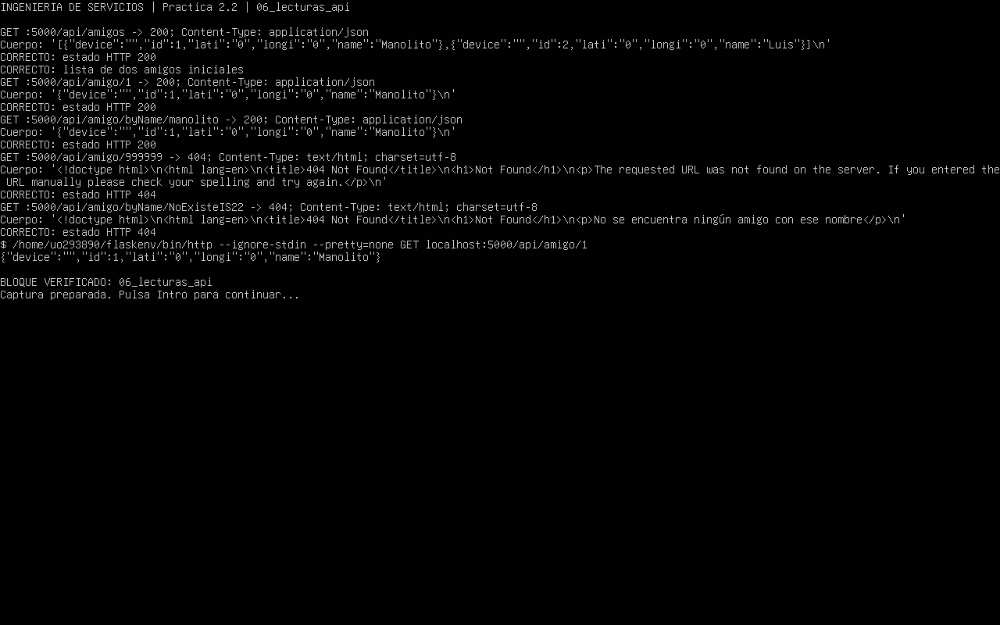

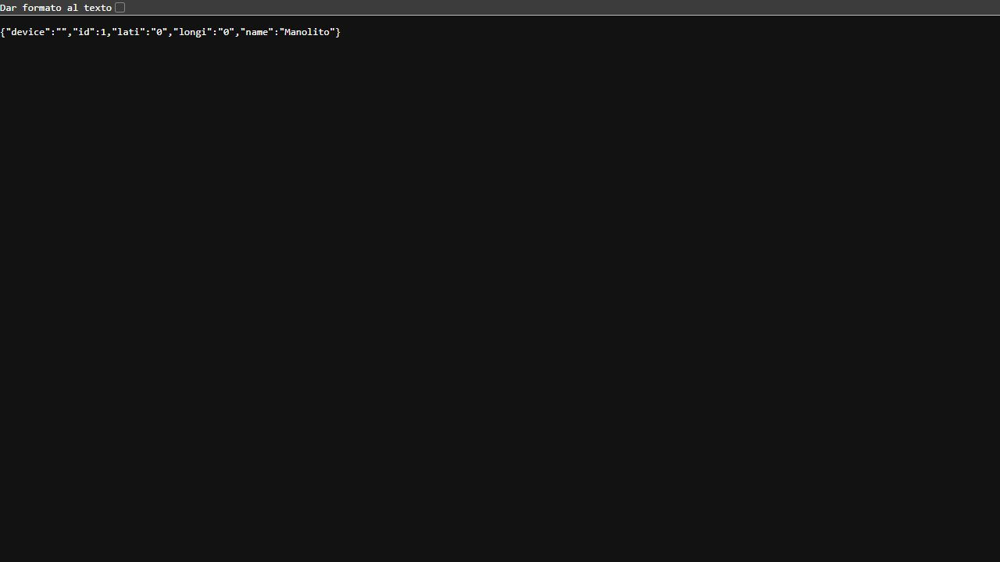

Se utilizó HTTPie desde `~/flaskenv`, además del cliente del verificador. Los GET incluyen `device` tanto en el recurso individual como en la búsqueda por nombre y en la lista. La representación JSON mantiene la decisión del código previo de mostrar `""` para un dispositivo nulo; se comprobó su valor SQL NULL por separado tras la migración.

## 11. Creación de amigos con POST

La API crea recursos con `POST /api/amigos`, recibiendo un objeto JSON. La respuesta contiene el identificador asignado por MariaDB y usa **200**, como especifica el guion y su anexo.

```bash
http --json POST localhost:5000/api/amigos name=Javier
```

Se creó Javier con solo su nombre. Sus coordenadas quedaron como las cadenas `"0"` y su dispositivo, no especificado, quedó nulo en SQL y se presentó vacío en JSON.

Se verificaron respuestas 422 ante nombre duplicado, ausencia del nombre, JSON vacío, cuerpo sin JSON, lista en lugar de objeto y nombre superior a los 32 caracteres del modelo. Después de esos errores se pudo crear otro registro, demostrando que la aplicación seguía operativa.

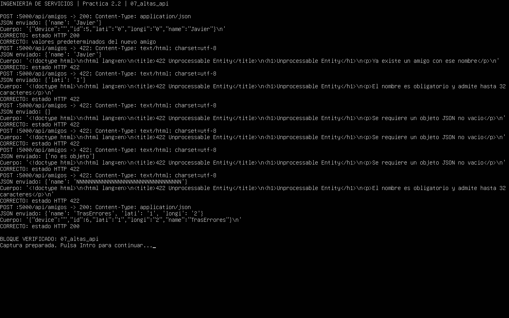

La lectura del cuerpo usa `request.get_json(silent=True)` y comprueba que el resultado sea un diccionario no vacío. Esto permite mantener el contrato 422 del ejercicio cuando falta JSON. La semántica de `request.json` depende de la versión de Flask y puede producir otro código antes de llegar a la validación de la aplicación. Referencia: https://flask.palletsprojects.com/en/stable/api/.

## 12. PUT y ejercicio de dispositivos

`PUT /api/amigo/<id>` actualiza los campos presentes en el objeto JSON. Se cambió la latitud de Javier a `"12"` y su dispositivo a `token-is22`; la respuesta devolvió los datos nuevos.

El ejercicio requiere distinguir ausencia del campo y cadena vacía. Si `device` no está en el JSON se conserva el valor anterior; si está y contiene `""`, se guarda la cadena vacía. No se utiliza una comprobación del tipo `if device`, que descartaría ese valor válido.

`GET /api/devices` filtra los valores SQL NULL y las cadenas vacías. Con el token de Javier devolvió `["token-is22"]`; al vaciarlo mediante PUT devolvió `[]`.

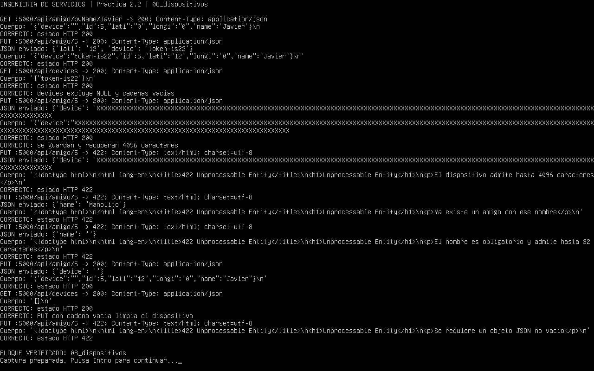

Se guardó y recuperó una cadena de **4096 caracteres**, comprobando su longitud. Una cadena de 4097 se rechazó con 422. También se rechazó renombrar a Javier como Manolito y enviar un nombre vacío, conservando la unicidad y el carácter obligatorio del nombre.

La validación se comparte con los formularios. Se aceptan cadenas para las coordenadas, como define el modelo del guion; esta práctica no incorpora un validador geográfico de rangos de latitud y longitud.

## 13. DELETE y códigos de error

Se creó el registro auxiliar TrasErrores y después se borró con `DELETE /api/amigo/<id>`. La respuesta fue **204 No Content**, con cuerpo vacío. Repetir el mismo DELETE devolvió **404**, porque el recurso ya no existía.

```bash
http DELETE localhost:5000/api/amigo/6
```

El identificador 6 corresponde al registro de esta ejecución. Los identificadores no tienen por qué ser consecutivos: MariaDB no reutiliza automáticamente los números de los amigos de prueba que se eliminaron antes.

También se comprobó que un PUT sobre un identificador inexistente devuelve 404 y que `PATCH /api/amigos`, método no implementado en esa ruta, devuelve 405.

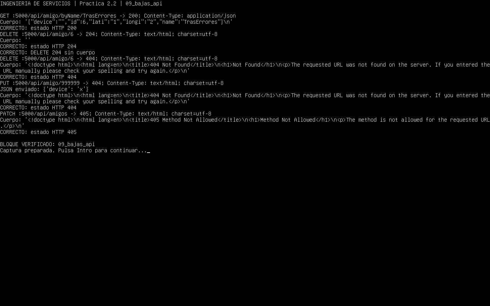

Los códigos observados resumen el contrato del laboratorio: 200 para las operaciones correctas con representación; 302 para las redirecciones de formularios; 204 para el borrado REST; 404 para recursos inexistentes; 405 para métodos no disponibles y 422 para los datos rechazados.

## 14. Comparación con la imagen 1.0

Para comprobar la versión anterior sin deshacer los cambios de la VM, se reconstruyó `amigos:1.0` a partir de los fuentes del commit previo **028ddc6**, en una carpeta temporal separada. Se añadió a esa copia únicamente la configuración de ejecución que lee `DATABASE_URI` del entorno, necesaria para arrancar el código histórico sin copiar secretos locales.

Se conservaron los tags anteriores mediante alias de respaldo. La versión 1.0 se ejecutó en el contenedor temporal `is22_version1`, sin publicar puertos, conectado a la misma base de verificación solo para consultar los datos.

La petición a `/api/amigos` devolvió HTTP 200 con los campos `id`, `name`, `lati` y `longi`, sin `device`. Así se comprueba la interfaz anterior y se diferencia de la versión 2.0 final. Esta comparación se realizó como prueba adicional después del despliegue final, sin sustituir el servicio expuesto por Nginx.

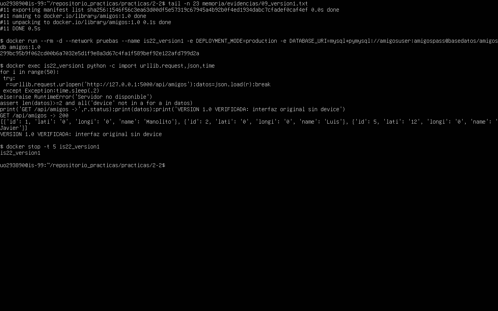

La respuesta incluyó Manolito, Luis y Javier, que ya existían en la base al realizar la comparación. La versión anterior ignora la columna adicional del esquema. El contenedor temporal se detuvo al terminar y la versión 2.0 siguió siendo la desplegada para el usuario.

## 15. Imagen final amigos:2.0

Se reconstruyó la imagen con el Dockerfile original de la aplicación. Sus dependencias incluyen Flask, Gunicorn, Flask-SQLAlchemy, PyMySQL y Flask-Migrate. El proceso de arranque sigue siendo Gunicorn con cuatro workers y el objeto `lanzar:app`.

```bash
cd amigos
docker build -t amigos:2.0 .
```

Se conserva la base `python:3.7` del guion. En la imagen final se verificaron **Flask 2.2.5** y **SQLAlchemy 2.0.55**, distintos de los paquetes de Ubuntu. El Dockerfile no fija esas versiones: son las resueltas en esta construcción.

Se corrigió `.dockerignore`, que contenía el texto de un comando de shell en vez de una lista de patrones. Ahora excluye `instance/`, cachés, datos y archivos locales. Se comprobó dentro de la imagen que **no existe `/amigos/instance/config.py`** y que la aplicación arranca recibiendo la URI por una variable de entorno.

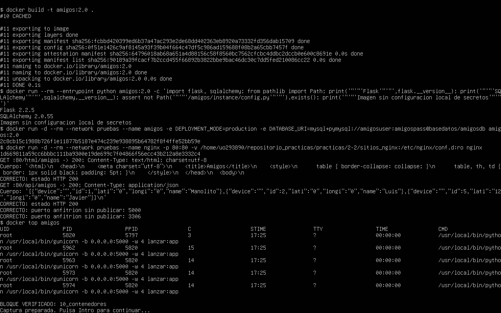

El puerto 5000 se declara en la imagen y Gunicorn escucha dentro del contenedor, pero no se publica mediante `-p`. Se detuvo el servidor de desarrollo de Ubuntu antes de esta fase y se confirmó que el puerto 5000 de la VM quedaba libre.

## 16. Nginx, Gunicorn y MariaDB

El despliegue final utiliza los contenedores `nginx`, `amigos` y `basedatos` en `pruebas`. Nginx publica `80:80`; los otros dos usan exclusivamente sus puertos internos. La configuración de Nginx monta `sitios_nginx` en `/etc/nginx/conf.d` y dirige todas las rutas hacia `http://amigos:5000`.

```text
Windows -> Ubuntu:80 -> nginx -> amigos:5000 -> Gunicorn -> Flask
                                                       -> SQLAlchemy
                                                       -> basedatos:3306
                                                       -> basedatos_verificacion/
```

El nombre `basedatos` de la URI se resuelve mediante el DNS de Docker. Se verificó HTTP 200 para la tabla HTML y la lista JSON a través del puerto 80. Las capturas siguientes ya corresponden al despliegue final, sin usar el servidor de desarrollo del puerto 5000.

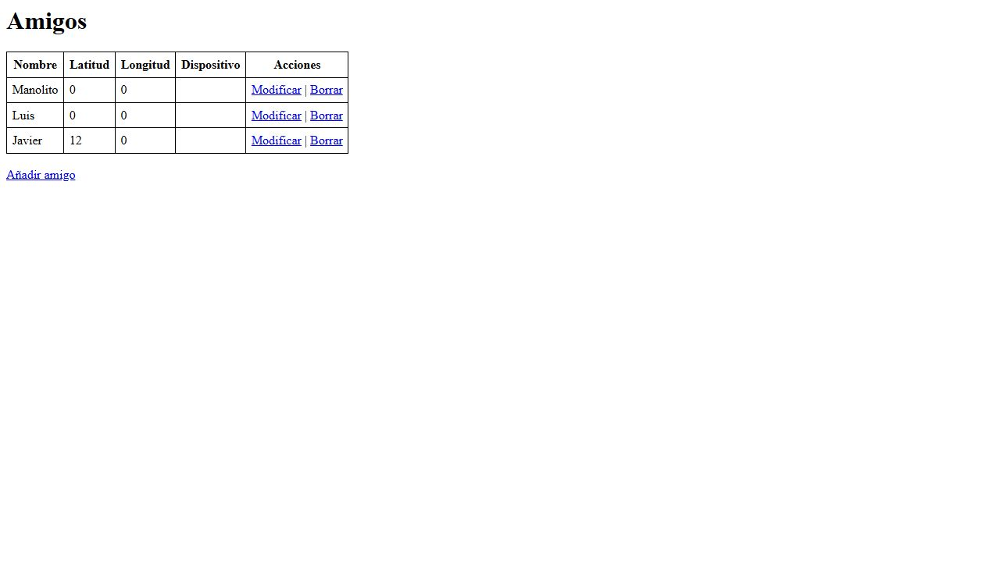

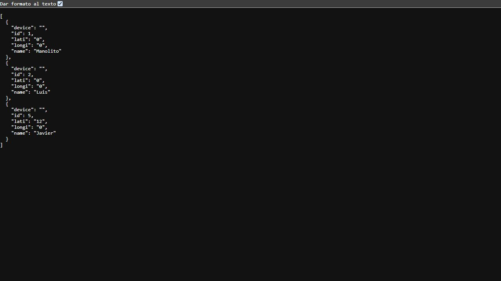

## 17. Persistencia al recrear MariaDB

Se leyó la lista JSON completa y se guardó como referencia. Después se detuvo `basedatos`, cuya opción `--rm` eliminó el contenedor. Se creó una nueva instancia con el mismo directorio `basedatos_verificacion` montado en `/var/lib/mysql`.

Tras comprobar que MariaDB estaba de nuevo disponible, se reinició el contenedor de la aplicación para renovar las conexiones de sus workers. Una nueva consulta por Nginx devolvió exactamente los mismos amigos y campos que antes de recrear el servidor SQL.

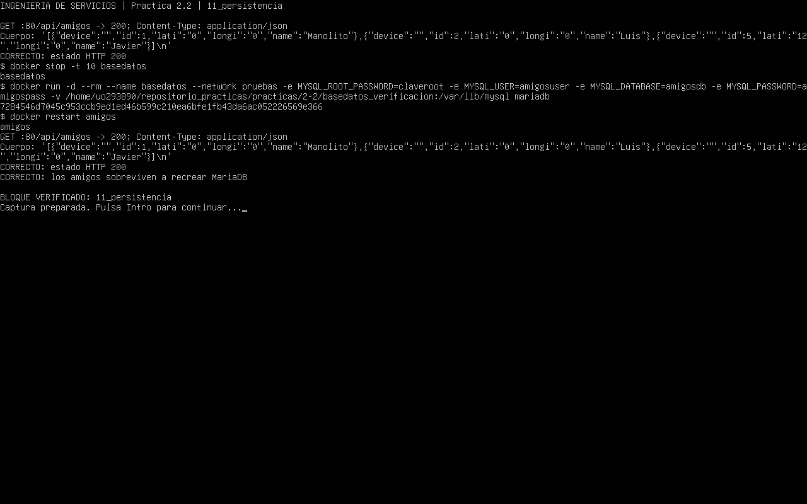

La persistencia depende del montaje del directorio del anfitrión, no de conservar el identificador del contenedor. Los datos permanecen aunque la instancia del servidor cambie. Las variables de inicialización se usan al preparar un directorio vacío; reutilizar un directorio ya inicializado recupera su base existente.

Los archivos físicos de MariaDB quedan fuera de Git. Se versionan el modelo, las migraciones, los scripts y las evidencias de las consultas. No se ha copiado ni alterado el contenido de las otras carpetas de bases de datos de la VM.

## 18. Limpieza final de dispositivos

El último apartado del guion pide retirar los tokens de prueba para no interferir con la práctica Android. Se actualizaron a `""` los dispositivos de los tres amigos de la base independiente: Manolito, Luis y Javier.

La consulta SQL de comprobación mostró longitud 0 para todos ellos y `GET /api/devices` devolvió una lista vacía. Se mantuvieron los nombres y coordenadas de ejemplo, incluido el cambio de latitud de Javier a `12`.

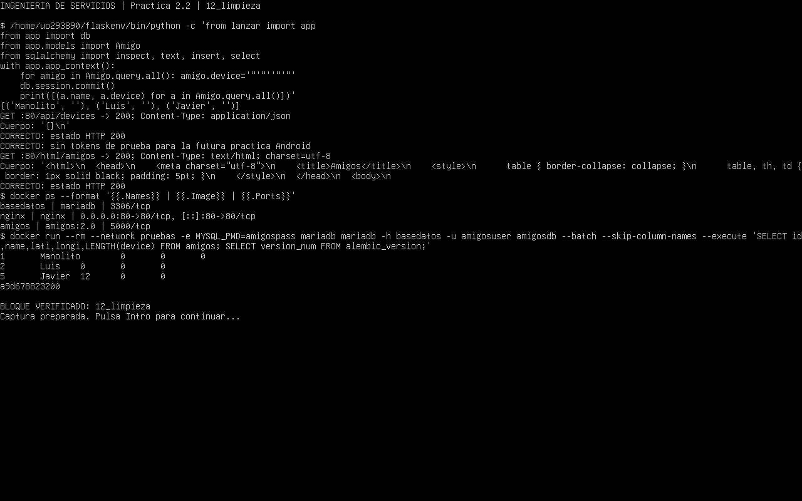

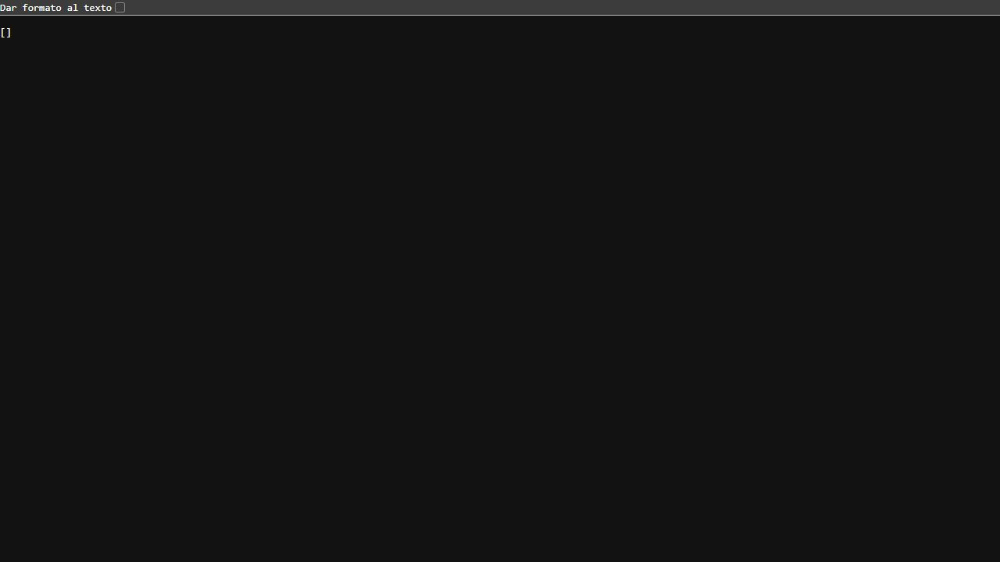

El archivo `resultados.json` contiene los **13 bloques correctos**, desde `00_entorno` hasta `12_limpieza`. La prueba adicional de la imagen 1.0 está en `09_version1.txt`. Las capturas de consola 02 y 09_version1 muestran fragmentos de registros guardados de estas ejecuciones; las demás se tomaron al finalizar los bloques correspondientes.

## 19. Archivos entregados y reproducción

Se incorporan los cinco archivos de la VM que estaban pendientes y se conserva su implementación del campo `device`, la vista y la ruta `/api/devices`. Se corrigen la correspondencia del modelo con la tabla `amigos`, la URL efectiva de migración y la validación necesaria para las entradas que exige probar el guion.

Se añaden la migración incremental de `device`, los tres scripts `lanza-basedatos.sh`, `lanza-flask.sh` y `lanza-nginx.sh`, los archivos de exclusión, el verificador, esta memoria y sus evidencias. El Dockerfile original mantiene su receta. Los cambios pendientes de otras prácticas permanecen fuera de esta entrega.

Se comprobó además el arranque con los tres scripts: se recrearon los servicios sobre la misma carpeta persistente y se recuperaron los tres amigos con dispositivos vacíos. El registro de esa prueba está en `13_lanzadores.txt`. El script de la aplicación permite cambiar su URI mediante `APP_DATABASE_URI`; por defecto utiliza el nombre DNS `basedatos`.

Para arrancar desde un clon se puede seguir el README de esta sesión: iniciar MariaDB con una carpeta independiente, esperar su inicialización, exportar la URI con su IP, ejecutar `flask --app lanzar db upgrade`, construir la imagen 2.0 e iniciar la aplicación y Nginx con los scripts.

```bash
cd ~/repositorio_practicas/practicas/2-2
DB_DIR=basedatos_verificacion bash lanza-basedatos.sh
# Esperar a que MariaDB este lista y aplicar las migraciones.
bash lanza-flask.sh
bash lanza-nginx.sh
```

El verificador con `--preparar --capturas` requiere una base de verificación **nueva y vacía**. No debe repetirse sobre los datos finales esperando que vuelva a crearlos: rechaza las tablas ya existentes. Para reanudar mediante `--desde` deben estar preparados los servicios y datos previos de ese bloque.

La memoria explica el comportamiento comprobado, sin atribuir a capturas antiguas ni a resultados de otras sesiones las pruebas actuales. Referencias técnicas utilizadas: Flask, https://flask.palletsprojects.com/en/stable/api/; Flask-SQLAlchemy, https://flask-sqlalchemy.palletsprojects.com/en/stable/quickstart/; y Flask-Migrate, https://flask-migrate.readthedocs.io/en/latest/. Consultadas el 17 de noviembre de 2026.
